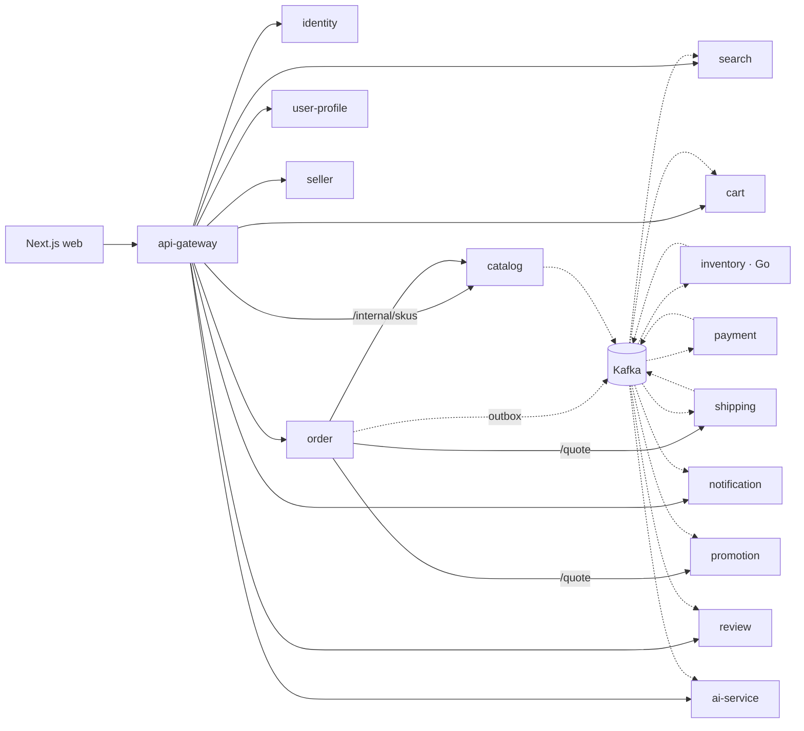
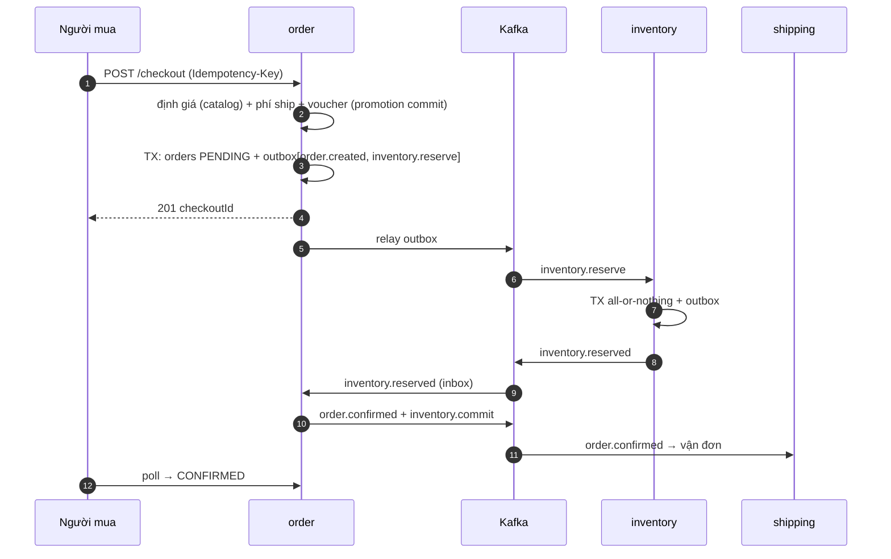
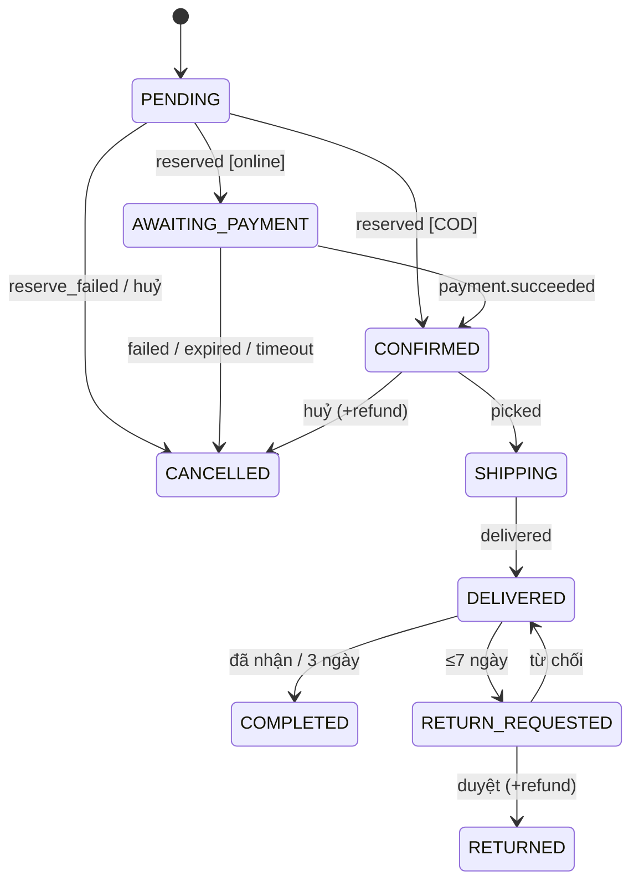
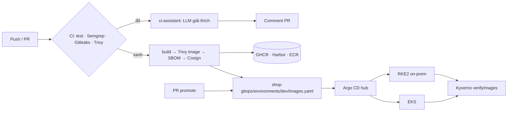
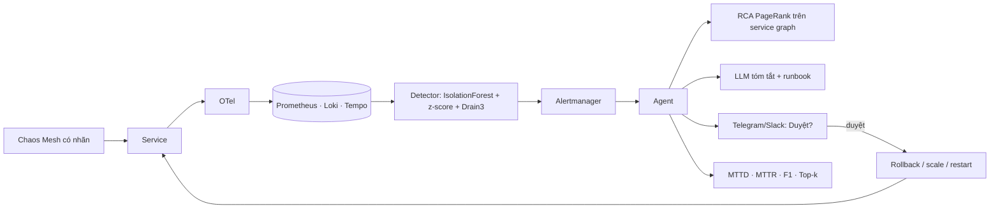

# Chương 2 — Phân tích & thiết kế hệ thống

Toàn bộ sơ đồ có mã nguồn PlantUML trong [diagrams/](diagrams/) (render: `diagrams/render.sh` → `diagrams/out/*.png|svg`).
Năm sơ đồ chính được nhúng lại dưới dạng Mermaid để xem trực tiếp trên GitHub.

## 2.1. Danh mục sơ đồ

| Nhóm UML / kiến trúc | File | Nội dung |
|---|---|---|
| C4 mức 1 — Ngữ cảnh | `c4-1-context.puml` | Hệ thống, tác nhân, hệ thống ngoài |
| C4 mức 2 — Container | `c4-2-container.puml` | 15 service, Kafka, kho dữ liệu |
| C4 mức 3 — Thành phần | `c4-3-component-order.puml` | Bên trong order-service |
| Use case | `usecase-buyer.puml`, `usecase-seller-admin.puml`, `usecase-platform.puml` | 3 phân hệ + nền tảng DevSecOps/AIOps |
| Lớp (domain) | `class-domain.puml` | Aggregate, entity, value object theo bounded context |
| ERD | `erd.puml` | Lược đồ database-per-service + bảng outbox/inbox |
| Tuần tự | `seq-checkout-cod`, `seq-payment-failure`, `seq-auth`, `seq-product-publish`, `seq-cicd-gitops`, `seq-canary`, `seq-aiops-incident` | Saga, bù trừ, xác thực, lan truyền sự kiện, CI/CD, canary, xử lý sự cố |
| Hoạt động | `activity-checkout`, `activity-return`, `activity-ci`, `activity-aiops` | Quy trình nghiệp vụ & vận hành |
| Trạng thái | `state-order`, `state-others` (payment, shipment, reservation, product, shop), `state-incident` | Máy trạng thái |
| Triển khai | `deploy-hybrid`, `deploy-aws`, `deploy-onprem` | Hạ tầng hybrid |
| Mạng & bảo mật | `network-security.puml` | Zero-trust, NetworkPolicy, admission |
| Luồng sự kiện | `kafka-topology.puml` | Producer → topic → consumer |
| Quan sát | `observability.puml` | OTel → LGTM → AIOps |
| Kế hoạch | `gantt-plan.puml`, `mindmap-stack.puml` | Tiến độ 16 tuần, bản đồ công nghệ |

## 2.2. Phong cách kiến trúc & lý do

| Quyết định | Lựa chọn | Phương án bị loại | Lý do |
|---|---|---|---|
| Phân rã | 15 service theo bounded context (DDD) | Monolith module hoá | Đề tài yêu cầu microservice; tách được tải (search, inventory) và lỗi (payment) |
| Nhất quán | Saga **orchestration** (order làm nhạc trưởng) | 2PC, choreography thuần | 2PC không chạy qua Kafka/HTTP; orchestration dễ nhìn trạng thái, dễ thêm bù trừ |
| Phát sự kiện | **Transactional Outbox** + relay `FOR UPDATE SKIP LOCKED` | Ghi DB rồi publish | Tránh mất sự kiện khi crash giữa hai bước (dual-write) |
| Nhận sự kiện | **Inbox** `processed_events` trong cùng transaction | Tin Kafka exactly-once | Kafka chỉ đảm bảo at-least-once giữa các hệ |
| Message broker | Kafka (Strimzi / Redpanda / MSK) | RabbitMQ | Lưu lại để replay, consumer group, thứ tự theo key, hệ sinh thái CDC |
| Dữ liệu | Database-per-service, polyglot (PG, Redis, Mongo, OpenSearch) | Một DB dùng chung | Ghép lỏng; chọn kho hợp với từng truy vấn |
| Giao tiếp đồng bộ | HTTP/JSON + timeout + retry + circuit breaker, chỉ để đọc/báo giá | gRPC | Đơn giản, debug dễ; thay đổi trạng thái luôn đi qua sự kiện |
| Xác thực | JWT RS256 + JWKS, mỗi service tự verify | Session ở gateway | Zero-trust; xoay khoá qua `kid` |
| Gateway | Fastify gateway + BFF | Kong / Envoy | BFF chịu lỗi từng phần cần code; có thể đặt Envoy Gateway phía trước |
| CD | GitOps Argo CD ApplicationSet (hub-spoke) | `kubectl apply` từ CI | Git là nguồn sự thật, tự sửa drift, audit qua PR, đa cụm |
| Release | Argo Rollouts canary + AnalysisTemplate | Rolling update | Tự rollback theo SLI |
| Bảo mật chuỗi cung ứng | SBOM Syft + Cosign keyless + Kyverno verifyImages | Chỉ quét lỗ hổng | Chứng minh được nguồn gốc image (SLSA) |
| Quan sát | OpenTelemetry + LGTM | ELK + Prometheus tách rời (v1) | Một chuẩn cho 3 loại tín hiệu, nối được log ↔ trace |
| AIOps | IsolationForest + robust z-score + PageRank RCA + LLM agent | LSTM/Transformer | Nhẹ, không cần GPU, giải thích được; LLM chỉ để tóm tắt và chọn runbook |

## 2.3. Phân rã service & dữ liệu

| Service | Sở hữu dữ liệu | Publish | Consume |
|---|---|---|---|
| identity | users, refresh_tokens, otp_codes, signing_keys | identity.user.v1 | seller.shop.v1 |
| user-profile | profiles, addresses, wishlist, recently viewed (Redis) | — | identity.user.v1 |
| seller | shops (KYC mã hoá AES-256-GCM), follows | seller.shop.v1 | — |
| catalog | categories, products, variants, banners, shops_cache | catalog.product.v1 | seller.shop.v1, review.v1, order.v1 |
| search | search_products (bỏ dấu, pg_trgm) / chỉ mục OpenSearch | — | catalog.product.v1, inventory.event.v1 |
| inventory (Go) | skus, stock, reservations, stock_movements | inventory.event.v1 | inventory.command.v1, catalog.product.v1 |
| cart | `cart:{user}` (Redis hash) | — | order.v1 |
| promotion | vouchers, redemptions, flash_sales, quotes (+ Redis Lua) | — | order.v1 |
| order | checkouts, orders, items, history, idempotency | order.v1, inventory.command.v1, payment.command.v1 | inventory.event.v1, payment.event.v1, shipping.v1 |
| payment | payments, payment_events, refunds, ledger, payouts | payment.event.v1 | payment.command.v1, order.v1 |
| shipping | shipments, shipment_events | shipping.v1 | order.v1 |
| review | reviews, purchases (Mongo) | review.v1 | order.v1 |
| notification | notifications (Mongo), SSE qua Redis pub/sub | — | gần như mọi topic |
| ai-service | products, co_purchase, user_history | — | catalog.product.v1, order.v1 |

## 2.4. Sơ đồ chính (Mermaid)

### Container và luồng chính

### Saga checkout COD

### Máy trạng thái đơn hàng

### CI/CD → GitOps hybrid

### AIOps vòng kín

## 2.5. Thiết kế thuật toán AIOps

**Đặc trưng** mỗi service *s*, mỗi bước 30 s: $x_s(t) = [p95, \text{error\_rate}, \text{rps}, \text{cpu}, \text{mem}, \text{dlq\_rate}]$.

1. **Robust z-score**: $z_i = \dfrac{x_i - \operatorname{median}(X_w)}{1.4826 \cdot \operatorname{MAD}(X_w)}$ trên cửa sổ trượt *w*;
   điểm thành phần $a^{z} = \sigma(\max_i |z_i| - 3)$.
2. **IsolationForest** huấn luyện trên dữ liệu bình thường; điểm $a^{IF} = $ chuẩn hoá $-\text{score\_samples}$ về [0, 1].
3. **Log**: Drain3 gom template; $a^{log}$ tăng khi có template mới hoặc tần suất template lỗi vượt $\mu + 3\sigma$.
4. **Điểm gộp** $A_s = \max(a^{IF}, a^{z}, a^{log})$; cảnh báo khi $A_s > \theta$ trong ≥ 2 bước liên tiếp (giảm báo động giả).
5. **RCA (kiểu MicroRCA)**: đồ thị gọi $G$ từ `traces_service_graph_request_total`; đảo chiều cạnh (lỗi lan ngược về phía
   gọi); trọng số cạnh $w_{uv} = A_v \cdot |\rho(x_u, x_v)|$; personalized PageRank với vector cá nhân hoá $\propto A_s$ →
   xếp hạng nguyên nhân gốc.
6. **Chỉ số**: Precision, Recall, $F1 = \frac{2PR}{P+R}$ theo cửa sổ sự cố; $MTTD = t_{detect} - t_{fault}$;
   $MTTR = t_{resolve} - t_{detect}$; Top-k = tỉ lệ thí nghiệm có nhãn nguyên nhân nằm trong k vị trí đầu.

## 2.6. Thiết kế bảo mật (theo OWASP ASVS / SLSA)

| Lớp | Biện pháp |
|---|---|
| Danh tính | argon2id, OTP băm + giới hạn 5 lần, khoá 15' sau 5 lần sai, 2FA TOTP, refresh token xoay vòng + phát hiện dùng lại |
| Token | RS256, `kid`, JWKS cache, iss/aud/exp; mỗi service tự verify (zero-trust) |
| API | zod validate mọi body, rate limit Redis, chặn `/internal` ở gateway (kể cả biến thể mã hoá URL), CORS, idempotency |
| Dữ liệu | KYC mã hoá AES-256-GCM, che số khi trả về, tiền dùng số nguyên, không có SQL nối chuỗi từ input |
| Mạng | NetworkPolicy deny-by-default, TLS ở biên, webhook có chữ ký HMAC (VNPay SHA-512, hãng vận chuyển SHA-256) |
| Container | non-root UID 10001, read-only rootfs, drop ALL, seccomp RuntimeDefault, image distroless (Go) |
| Chuỗi cung ứng | Gitleaks, Semgrep, Trivy fs/image/config, SBOM SPDX, Cosign keyless + attest, Kyverno verifyImages |
| Bí mật | External Secrets ← Vault / AWS Secrets Manager; GitHub OIDC → AWS (không có access key dài hạn) |
| Vận hành AI | Tác tử chỉ thực thi trong allowlist, có người duyệt, DRY_RUN mặc định, audit log, nút duyệt ký HMAC |
