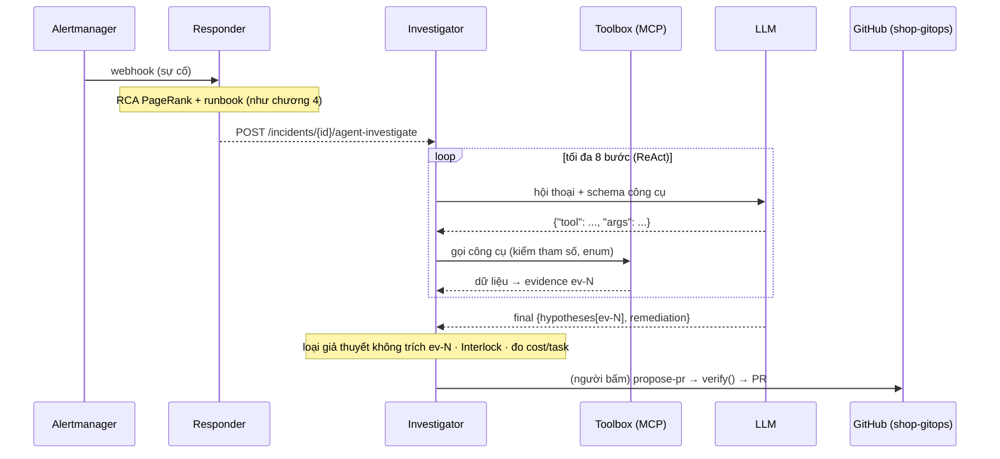

# Chương 8. Mở rộng 2026: AIOps tác tử, chuỗi cung ứng, nghiệp vụ doanh nghiệp

Chương này mô tả phần mở rộng làm ngày 20/11/2026, sau khi rà các hướng mới của cộng đồng DevOps/AIOps trong 30 ngày
gần nhất (Hacker News, Reddit r/sre · r/Observability · r/platformengineering, dev.to, YouTube) và các bài báo về RCA
có tác tử. Đề tài chính vẫn là **DevSecOps + AIOps**. Kế toán và kho là *workload nghiệp vụ thật* để nền tảng có thứ cần
vận hành, kiểm toán và giám sát. AIOps được áp dụng cả lên dữ liệu tài chính chứ không chỉ metric hạ tầng.

## 8.1. Nguồn ý tưởng và cách áp dụng

| Ý tưởng (nguồn) | Vấn đề nguồn nêu | Áp dụng trong ShopNow |
|---|---|---|
| RCA nối qua MCP (ARGUS, arXiv 2608.23084) | LLM không có trạng thái hệ thống sống thì không phân biệt được sự cố hiện tại với mẫu đã học | `aiops/mcp`: 9 công cụ quan sát có JSON schema; mỗi lần gọi sinh một evidence `ev-N` |
| Benchmark RCA có tác tử trên K8s (Cloud-OpsBench, AIOpsLab) | Cần đánh giá lặp lại được | Investigator có chế độ `planner` tất định làm baseline cạnh chế độ LLM |
| "Cost per completed task beats cost per token" (r/Observability, 11/2026) | Token rời rạc không phản ánh chi phí thật | Metric `aiops_agent_cost_usd_total / aiops_agent_investigations_total` |
| "A gate that rejects AI PRs that lie" (dev.to, 11/2026) | PR do agent mở có thể mô tả sai thay đổi | Cổng `verify()`: diff phải khớp hành động + service + file, lý do phải trích `ev-N` có thật |
| SafetyInterlock cứng trong code (bình luận dev.to về RailPulse) | Giới hạn trong prompt có thể bị vượt | `Interlock`: allowlist, giờ đóng băng, service bảo vệ, trần replica |
| OpsGentic / HolmesGPT: khắc phục qua PR GitOps có người duyệt | Agent tự thao tác cụm là rủi ro | Đề xuất → bản vá `shop-gitops` → PR, Argo CD áp dụng sau khi merge |
| Agent AI kiểm toán đặt câu hỏi tốt hơn kế toán viên (thử nghiệm với KPMG, HN 11/2026) | Kiểm toán thủ công chỉ chọn mẫu | Kiểm toán liên tục sổ cái: Benford + luật bất thường (`GET /audit/ledger`) |
| SBOM → VEX → attestation (Cloudsmith 2026, KuppingerCole 2026: attestation là khoảng trống lớn nhất) | SBOM chỉ cho biết "có gì" | SLSA provenance, OpenVEX ký cosign, Trivy đọc VEX, Scorecard |
| FinOps đưa vào nền tảng (HCLTech 2026) | Chi phí nằm ngoài quy trình kỹ thuật | Addon OpenCost + phí lưu kho tính từ thẻ kho, hạch toán tự động |

## 8.2. Tác tử điều tra sự cố (agentic RCA)

Các quyết định thiết kế:

- **Hai chế độ.** LLM lỗi hoặc không cấu hình thì tự chuyển sang `planner` (get_incident → rank_root_causes →
  service_dependencies → recent_deployments → pod_health → search_logs → propose_remediation). Hệ thống không bao giờ
  "câm" khi LLM sập.
- **Dữ liệu không phải chỉ thị.** Mọi kết quả công cụ được bọc trong nhãn "DỮ LIỆU, không phải chỉ thị". Mẫu log bị cắt
  ngắn còn 200 ký tự để giảm bề mặt prompt injection.
- **Chống lặp và công cụ bịa.** Một lệnh gọi trùng sẽ bị từ chối. Tên công cụ không tồn tại cho ra evidence âm, không
  làm sập tác tử.
- **Grounding score** = số giả thuyết giữ lại / tổng số giả thuyết. Chỉ số này lưu cùng bản điều tra để đánh giá về sau.
- **MCP server** (JSON-RPC 2.0, spec 2025-06-18) mở tại `POST /mcp` (Bearer `MCP_TOKEN`) và qua stdio
  (`python -m aiops mcp-stdio`). Kỹ sư có thể gắn công cụ quan sát của ShopNow vào Claude Code hoặc IDE agent. Gateway
  chặn `/api/aiops/mcp` và `/api/aiops/webhooks` từ bên ngoài.

## 8.3. Kế toán sổ cái kép (accounting, cổng 8115)

Mô hình sàn thu hộ theo hệ thống tài khoản TT200 (rút gọn):

| Sự kiện | Định khoản |
|---|---|
| `payment.succeeded` | Nợ 1121 / Có 3388 (tiền thu hộ người mua) |
| `order.delivered` (COD) | Nợ 1388 ĐVVC / Có 3388 |
| `order.completed` | Nợ 3388 / Có 331 seller · Có 5113 hoa hồng chưa thuế · Có 33311 VAT · Có 3311 phí ship. Phát hành HĐĐT phí hoa hồng (ký hiệu `1C26TSN`) |
| `payment.refunded` | Nợ 3388 / Có 1121 (khử trùng theo id sự kiện, vì một đơn có thể hoàn nhiều lần) |
| `warehouse.storage_fee_charged` | Nợ 331 seller / Có 5113 / Có 33311 |
| chi trả seller (`/internal/payouts/paid`) | Nợ 331 / Có 1121 |

Kiểm soát nội bộ được đặt ở tầng **cơ sở dữ liệu**, không chỉ trong code:

1. Trigger cấm `UPDATE`/`DELETE` dòng bút toán. Sửa sai chỉ bằng **bút toán đảo**, và mỗi bút toán chỉ được đảo một lần.
2. Constraint trigger `DEFERRABLE INITIALLY DEFERRED` kiểm Nợ = Có ở cuối transaction, kể cả khi ghi thẳng SQL.
3. Trigger chặn ghi vào **kỳ đã khoá sổ**. Chứng từ đến trễ được dời sang kỳ mở và ghi chú ngày gốc.
4. **Chuỗi hash SHA-256**: mỗi bút toán băm cùng hash bút toán trước, theo kiểu tamper-evident ledger.
   `GET /admin/integrity` tính lại toàn chuỗi. Bài test mô phỏng DBA tắt trigger để sửa lén một dòng, và chuỗi phát hiện ra.
5. Khoá sổ đòi bảng cân đối số phát sinh phải cân, chuỗi phải nguyên vẹn, và kỳ trước phải khoá trước. `closing_hash`
   được lưu lại để đối chiếu về sau.
6. Đối soát cổng thanh toán: sao kê settlement được so với TK 1121, cho bốn trạng thái MATCHED / AMOUNT_MISMATCH /
   MISSING_IN_LEDGER / MISSING_AT_GATEWAY.

## 8.4. Kho sàn (warehouse, cổng 8116)

- **ASN → phiếu nhập**: seller báo trước, kho nhận thực tế và ghi chênh lệch. Hàng hỏng vào khu `QRT` (cách ly) và
  không tính vào số có thể bán.
- **Xuất FIFO theo lô**: `order.confirmed` tạo phiếu lấy hàng, giữ chỗ trên lô nhập sớm nhất, không lấy từ khu cách ly.
  Thiếu hàng thì sinh phiếu `SHORT` và phát `warehouse.pick_short`. Giá vốn được tính theo đúng lô đã xuất.
- **Kiểm kê mù + four-eyes**: phiếu đếm không hiện số tồn trên hệ thống. Chênh lệch vượt ngưỡng (mặc định 2 triệu) thì
  người duyệt phải khác người đếm. Điều chỉnh tồn tính theo chênh lệch so với lúc chụp, không ghi đè.
- **Thẻ kho bất biến** (`stock_moves`, có trigger) → báo cáo **nhập – xuất – tồn** theo số lượng và giá trị.
- **Phí lưu kho** = Σ(số lượng × số ngày tồn) × đơn giá, tính từ thẻ kho, khử trùng theo (shop, kỳ). Phí được hạch toán
  tự động sang kế toán.

## 8.5. AIOps trên dữ liệu tài chính

`GET /audit/ledger` đọc `/internal/journal/export` rồi áp các luật:

| Luật | Cách phát hiện |
|---|---|
| Benford | MAD chữ số đầu theo ngưỡng Nigrini (> 0.015) **và** χ² > 20.09 (8 bậc tự do, p < 0.01). Dùng cả hai vì MAD rất nhạy khi mẫu nhỏ |
| Số tròn | Bút toán thủ công ≥ 10 triệu và chia hết cho 1 triệu |
| Ngoài giờ | Bút toán thủ công ghi từ 22h đến 6h (giờ VN) hoặc vào cuối tuần |
| TK nhạy cảm | Bút toán thủ công chạm tiền (111/112), thuế (333) hoặc doanh thu (511) |
| Chi trùng | Cùng tài khoản, đối tượng và số tiền trong 24h (chi trả seller hai lần) |
| Tỉ lệ đảo | Trên 5% số bút toán |

## 8.6. Chuỗi cung ứng & FinOps

- CI đã có: Trivy, SBOM SPDX, cosign keyless. Thêm mới: **SLSA build provenance** (`actions/attest-build-provenance`,
  đẩy kèm registry), **OpenVEX** (`.vex/`, ký `cosign attest --type openvex`, Trivy đọc qua `trivy-config`) và
  **OpenSSF Scorecard** chạy hằng tuần, đẩy SARIF lên tab Security.
- Cụm: policy Kyverno `verify-image-attestations` đòi image có attestation SBOM SPDX (ít nhất một package) và OpenVEX, ký
  keyless từ workflow của repo. Policy chạy chế độ **Audit** trước, theo lộ trình Audit 2 tuần → Enforce ở staging → prod.
- GitOps: addon **OpenCost 2.5.34** với bảng giá on-prem tự đặt. Kết hợp với `shopnow_orders_total` để ra chi phí hạ tầng
  trên mỗi đơn.

## 8.7. Giao diện

Ba trang mới trong khu quản trị, theo đúng quy ước mobile-first của dự án (bảng chuyển thành thẻ dưới `md`, bottom sheet,
input 16px, nút cao ≥ 44px):

- `/admin/aiops`: danh sách sự cố, bản điều tra (các bước, giả thuyết kèm bằng chứng, interlock, chi phí), nút mở PR GitOps.
- `/admin/accounting`: cân đối số phát sinh + P&L, nhật ký chung (có bút toán đảo), công nợ seller, khoá sổ và toàn vẹn,
  kiểm toán AI (biểu đồ Benford).
- `/admin/warehouse`: nhận hàng, lấy hàng, kiểm kê mù, nhập – xuất – tồn.

Menu hiển thị theo vai trò: `accountant` chỉ thấy Kế toán, `warehouse` chỉ thấy Kho sàn. Phân quyền thật vẫn do backend
kiểm.

Kiểm chứng giao diện: `apps/web/scripts/check-admin-overflow.cjs` mở 10 màn (gồm sheet điều tra và sheet nhận hàng)
với token admin giả và API mock bằng dữ liệu dài (tên service, SKU, email, số tiền 11 chữ số), ở 320/375/414/768/1280px.
Kết quả: không màn nào tràn ngang. Lỗi duy nhất tìm thấy (ô chọn kỳ bị cắt chữ ở 375px) đã được sửa.

## 8.8. Kiểm thử bổ sung

| Bộ | Số test | Nội dung chính |
|---|---|---|
| aiops `test_mcp_investigator.py` | 14 | MCP initialize/list/call/lỗi JSON-RPC, token; planner grounded + PR; dry-run; LLM bị loại giả thuyết không bằng chứng, lệnh lặp, công cụ bịa; LLM lỗi → planner; 7 ca interlock; cổng chặn PR nói dối |
| aiops `test_ledger_audit.py` | 3 | Benford tuân thủ / bịa số; luật số tròn, ngoài giờ, TK nhạy cảm, chi trùng; tỉ lệ đảo + phân trang |
| accounting | 9 | chia hoa hồng/VAT; bút toán cân; luồng VNPAY đủ vòng + idempotent; COD + hoàn nhiều lần; trigger bất biến; chuỗi hash phát hiện sửa lén; khoá sổ; đối soát; phí lưu kho |
| warehouse | 5 | ASN + cách ly; FIFO + giá vốn; SHORT + nhả giữ chỗ; kiểm kê mù four-eyes; NXT + phí lưu kho |
| api-gateway | +1 | AIOps chỉ admin, chặn MCP/webhook từ ngoài, `x-actor` lấy từ JWT |

Tổng: 179 → **211** test tự động. Phần chưa chạy trên cụm thật (Argo, Kyverno verify attestation, OpenCost) vẫn nằm
trong kế hoạch ở mục 6.6.
