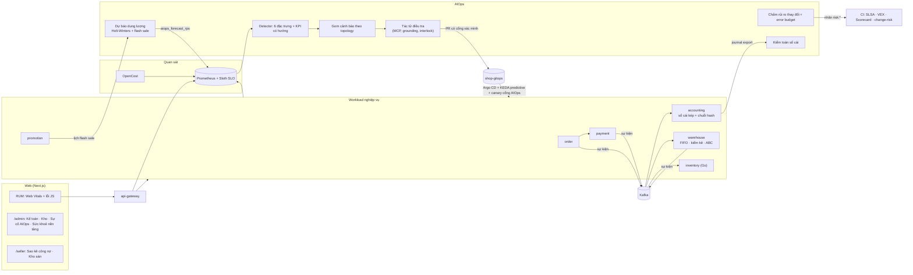
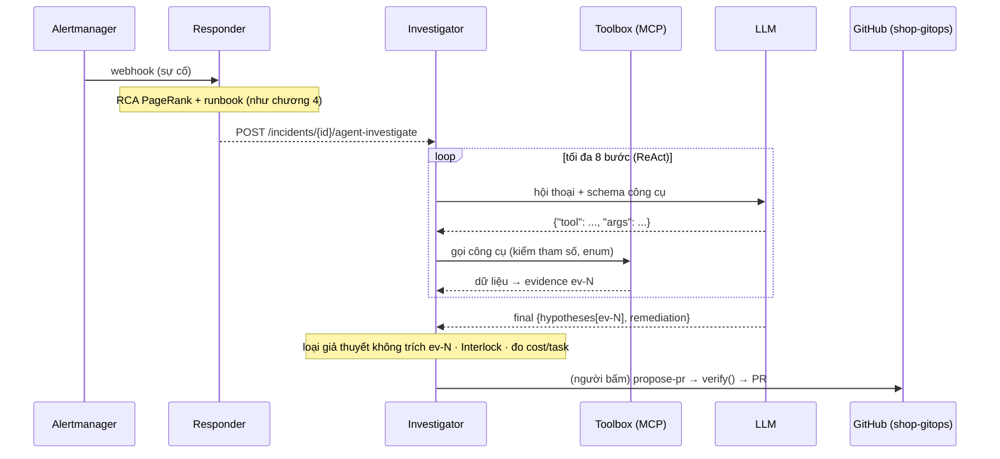

# Chương 8. Mở rộng 2026: AIOps tác tử, chuỗi cung ứng, nghiệp vụ doanh nghiệp

Chương này mô tả phần mở rộng làm ngày 20/11/2026, sau khi rà các hướng mới của cộng đồng DevOps/AIOps trong 30 ngày
gần nhất (Hacker News, Reddit r/sre · r/Observability · r/platformengineering, dev.to, YouTube) và các bài báo về RCA
có tác tử. Đề tài chính vẫn là **DevSecOps + AIOps**. Kế toán và kho là *workload nghiệp vụ thật* để nền tảng có thứ cần
vận hành, kiểm toán và giám sát. AIOps được áp dụng cả lên dữ liệu tài chính chứ không chỉ metric hạ tầng.

### Tổng quan phần mở rộng

## 8.1. Nguồn ý tưởng và cách áp dụng

| Ý tưởng (nguồn) | Vấn đề nguồn nêu | Áp dụng trong ShopNow |
|---|---|---|
| RCA nối qua MCP (ARGUS, arXiv 2608.23084) | LLM không có trạng thái hệ thống sống thì không phân biệt được sự cố hiện tại với mẫu đã học | `aiops/mcp`: 9 công cụ quan sát có JSON schema; mỗi lần gọi sinh một evidence `ev-N` |
| Benchmark RCA có tác tử trên K8s (Cloud-OpsBench, AIOpsLab) | Cần đánh giá lặp lại được | Investigator có chế độ `planner` tất định làm baseline cạnh chế độ LLM |
| "Cost per completed task beats cost per token" (r/Observability, 11/2026) | Token rời rạc không phản ánh chi phí thật | Metric `aiops_agent_cost_usd_total / aiops_agent_investigations_total` |
| "A gate that rejects AI PRs that lie" (dev.to, 11/2026) | PR do agent mở có thể mô tả sai thay đổi | Cổng `verify()`: diff phải khớp hành động + service + file, lý do phải trích `ev-N` có thật |
| SafetyInterlock cứng trong code (bình luận dev.to về RailPulse) | Giới hạn trong prompt có thể bị vượt | `Interlock`: allowlist, giờ đóng băng, service bảo vệ, trần replica |
| OpsGentic / HolmesGPT: khắc phục qua PR GitOps có người duyệt | Agent tự thao tác cụm là rủi ro | Đề xuất → bản vá `shop-gitops` → PR, Argo CD áp dụng sau khi merge |
| Agent AI kiểm toán đặt câu hỏi tốt hơn kế toán viên (thử nghiệm với KPMG, HN 11/2026) | Kiểm toán thủ công chỉ chọn mẫu | Kiểm toán liên tục sổ cái: Benford + luật bất thường (`GET /audit/ledger`) |
| SBOM → VEX → attestation (Cloudsmith 2026, KuppingerCole 2026: attestation là khoảng trống lớn nhất) | SBOM chỉ cho biết "có gì" | SLSA provenance, OpenVEX ký cosign, Trivy đọc VEX, Scorecard |
| FinOps đưa vào nền tảng (HCLTech 2026) | Chi phí nằm ngoài quy trình kỹ thuật | Addon OpenCost + phí lưu kho tính từ thẻ kho, hạch toán tự động |

## 8.2. Tác tử điều tra sự cố (agentic RCA)

Các quyết định thiết kế:

- **Hai chế độ.** LLM lỗi hoặc không cấu hình thì tự chuyển sang `planner` (get_incident → rank_root_causes →
  service_dependencies → recent_deployments → pod_health → search_logs → propose_remediation). Hệ thống không bao giờ
  "câm" khi LLM sập.
- **Dữ liệu không phải chỉ thị.** Mọi kết quả công cụ được bọc trong nhãn "DỮ LIỆU, không phải chỉ thị". Mẫu log bị cắt
  ngắn còn 200 ký tự để giảm bề mặt prompt injection.
- **Chống lặp và công cụ bịa.** Một lệnh gọi trùng sẽ bị từ chối. Tên công cụ không tồn tại cho ra evidence âm, không
  làm sập tác tử.
- **Grounding score** = số giả thuyết giữ lại / tổng số giả thuyết. Chỉ số này lưu cùng bản điều tra để đánh giá về sau.
- **MCP server** (JSON-RPC 2.0, spec 2025-06-18) mở tại `POST /mcp` (Bearer `MCP_TOKEN`) và qua stdio
  (`python -m aiops mcp-stdio`). Kỹ sư có thể gắn công cụ quan sát của ShopNow vào Claude Code hoặc IDE agent. Gateway
  chặn `/api/aiops/mcp` và `/api/aiops/webhooks` từ bên ngoài.

## 8.3. Kế toán sổ cái kép (accounting, cổng 8115)

Mô hình sàn thu hộ theo hệ thống tài khoản TT200 (rút gọn):

| Sự kiện | Định khoản |
|---|---|
| `payment.succeeded` | Nợ 1121 / Có 3388 (tiền thu hộ người mua) |
| `order.delivered` (COD) | Nợ 1388 ĐVVC / Có 3388 |
| `order.completed` | Nợ 3388 / Có 331 seller · Có 5113 hoa hồng chưa thuế · Có 33311 VAT · Có 3311 phí ship. Phát hành HĐĐT phí hoa hồng (ký hiệu `1C26TSN`) |
| `payment.refunded` | Nợ 3388 / Có 1121 (khử trùng theo id sự kiện, vì một đơn có thể hoàn nhiều lần) |
| `warehouse.storage_fee_charged` | Nợ 331 seller / Có 5113 / Có 33311 |
| chi trả seller (`/internal/payouts/paid`) | Nợ 331 / Có 1121 |

Kiểm soát nội bộ được đặt ở tầng **cơ sở dữ liệu**, không chỉ trong code:

1. Trigger cấm `UPDATE`/`DELETE` dòng bút toán. Sửa sai chỉ bằng **bút toán đảo**, và mỗi bút toán chỉ được đảo một lần.
2. Constraint trigger `DEFERRABLE INITIALLY DEFERRED` kiểm Nợ = Có ở cuối transaction, kể cả khi ghi thẳng SQL.
3. Trigger chặn ghi vào **kỳ đã khoá sổ**. Chứng từ đến trễ được dời sang kỳ mở và ghi chú ngày gốc.
4. **Chuỗi hash SHA-256**: mỗi bút toán băm cùng hash bút toán trước, theo kiểu tamper-evident ledger.
   `GET /admin/integrity` tính lại toàn chuỗi. Bài test mô phỏng DBA tắt trigger để sửa lén một dòng, và chuỗi phát hiện ra.
5. Khoá sổ đòi bảng cân đối số phát sinh phải cân, chuỗi phải nguyên vẹn, và kỳ trước phải khoá trước. `closing_hash`
   được lưu lại để đối chiếu về sau.
6. Đối soát cổng thanh toán: sao kê settlement được so với TK 1121, cho bốn trạng thái MATCHED / AMOUNT_MISMATCH /
   MISSING_IN_LEDGER / MISSING_AT_GATEWAY.

## 8.4. Kho sàn (warehouse, cổng 8116)

- **ASN → phiếu nhập**: seller báo trước, kho nhận thực tế và ghi chênh lệch. Hàng hỏng vào khu `QRT` (cách ly) và
  không tính vào số có thể bán.
- **Xuất FIFO theo lô**: `order.confirmed` tạo phiếu lấy hàng, giữ chỗ trên lô nhập sớm nhất, không lấy từ khu cách ly.
  Thiếu hàng thì sinh phiếu `SHORT` và phát `warehouse.pick_short`. Giá vốn được tính theo đúng lô đã xuất.
- **Kiểm kê mù + four-eyes**: phiếu đếm không hiện số tồn trên hệ thống. Chênh lệch vượt ngưỡng (mặc định 2 triệu) thì
  người duyệt phải khác người đếm. Điều chỉnh tồn tính theo chênh lệch so với lúc chụp, không ghi đè.
- **Thẻ kho bất biến** (`stock_moves`, có trigger) → báo cáo **nhập – xuất – tồn** theo số lượng và giá trị.
- **Phí lưu kho** = Σ(số lượng × số ngày tồn) × đơn giá, tính từ thẻ kho, khử trùng theo (shop, kỳ). Phí được hạch toán
  tự động sang kế toán.

## 8.5. AIOps trên dữ liệu tài chính

`GET /audit/ledger` đọc `/internal/journal/export` rồi áp các luật:

| Luật | Cách phát hiện |
|---|---|
| Benford | MAD chữ số đầu theo ngưỡng Nigrini (> 0.015) **và** χ² > 20.09 (8 bậc tự do, p < 0.01). Dùng cả hai vì MAD rất nhạy khi mẫu nhỏ |
| Số tròn | Bút toán thủ công ≥ 10 triệu và chia hết cho 1 triệu |
| Ngoài giờ | Bút toán thủ công ghi từ 22h đến 6h (giờ VN) hoặc vào cuối tuần |
| TK nhạy cảm | Bút toán thủ công chạm tiền (111/112), thuế (333) hoặc doanh thu (511) |
| Chi trùng | Cùng tài khoản, đối tượng và số tiền trong 24h (chi trả seller hai lần) |
| Tỉ lệ đảo | Trên 5% số bút toán |

## 8.6. Chuỗi cung ứng & FinOps

- CI đã có: Trivy, SBOM SPDX, cosign keyless. Thêm mới: **SLSA build provenance** (`actions/attest-build-provenance`,
  đẩy kèm registry), **OpenVEX** (`.vex/`, ký `cosign attest --type openvex`, Trivy đọc qua `trivy-config`) và
  **OpenSSF Scorecard** chạy hằng tuần, đẩy SARIF lên tab Security.
- Cụm: policy Kyverno `verify-image-attestations` đòi image có attestation SBOM SPDX (ít nhất một package) và OpenVEX, ký
  keyless từ workflow của repo. Policy chạy chế độ **Audit** trước, theo lộ trình Audit 2 tuần → Enforce ở staging → prod.
- GitOps: addon **OpenCost 2.5.34** với bảng giá on-prem tự đặt. Kết hợp với `shopnow_orders_total` để ra chi phí hạ tầng
  trên mỗi đơn.

## 8.7. Giao diện

Ba trang mới trong khu quản trị, theo đúng quy ước mobile-first của dự án (bảng chuyển thành thẻ dưới `md`, bottom sheet,
input 16px, nút cao ≥ 44px):

- `/admin/aiops`: danh sách sự cố, bản điều tra (các bước, giả thuyết kèm bằng chứng, interlock, chi phí), nút mở PR GitOps.
- `/admin/accounting`: cân đối số phát sinh + P&L, nhật ký chung (có bút toán đảo), công nợ seller, khoá sổ và toàn vẹn,
  kiểm toán AI (biểu đồ Benford).
- `/admin/warehouse`: nhận hàng, lấy hàng, kiểm kê mù, nhập – xuất – tồn.

Menu hiển thị theo vai trò: `accountant` chỉ thấy Kế toán, `warehouse` chỉ thấy Kho sàn. Phân quyền thật vẫn do backend
kiểm.

Kiểm chứng giao diện: `apps/web/scripts/check-admin-overflow.cjs` mở 10 màn (gồm sheet điều tra và sheet nhận hàng)
với token admin giả và API mock bằng dữ liệu dài (tên service, SKU, email, số tiền 11 chữ số), ở 320/375/414/768/1280px.
Kết quả: không màn nào tràn ngang. Lỗi duy nhất tìm thấy (ô chọn kỳ bị cắt chữ ở 375px) đã được sửa.

## 8.8. Kiểm thử bổ sung

| Bộ | Số test | Nội dung chính |
|---|---|---|
| aiops `test_mcp_investigator.py` | 14 | MCP initialize/list/call/lỗi JSON-RPC, token; planner grounded + PR; dry-run; LLM bị loại giả thuyết không bằng chứng, lệnh lặp, công cụ bịa; LLM lỗi → planner; 7 ca interlock; cổng chặn PR nói dối |
| aiops `test_ledger_audit.py` | 3 | Benford tuân thủ / bịa số; luật số tròn, ngoài giờ, TK nhạy cảm, chi trùng; tỉ lệ đảo + phân trang |
| accounting | 9 | chia hoa hồng/VAT; bút toán cân; luồng VNPAY đủ vòng + idempotent; COD + hoàn nhiều lần; trigger bất biến; chuỗi hash phát hiện sửa lén; khoá sổ; đối soát; phí lưu kho |
| warehouse | 5 | ASN + cách ly; FIFO + giá vốn; SHORT + nhả giữ chỗ; kiểm kê mù four-eyes; NXT + phí lưu kho |
| api-gateway | +1 | AIOps chỉ admin, chặn MCP/webhook từ ngoài, `x-actor` lấy từ JWT |

Tổng: 179 → **213** test tự động (thêm test RUM ở gateway và test hồi quy của bộ đánh giá tác tử ở mục 8.10). Phần chưa chạy trên cụm thật (Argo, Kyverno verify attestation, OpenCost) vẫn nằm
trong kế hoạch ở mục 6.6.

## 8.9. Quan sát phía người dùng (RUM)

Trình duyệt gom Core Web Vitals (LCP, INP, FCP, TTFB, CLS) và *loại* lỗi JS (`error`, `unhandledrejection`, lỗi render
React), rồi gửi lô qua `sendBeacon` dạng `text/plain` để tránh preflight CORS. Web không gửi nội dung lỗi hay URL đầy đủ,
để khỏi lộ dữ liệu cá nhân. Gateway `POST /api/rum` kiểm payload bằng zod, chuẩn hoá đường dẫn về mẫu route (id/slug thành
`:id`, tối đa 200 route) để giới hạn số chuỗi metric, và xuất `web_vitals_seconds`, `web_vitals_cls`, `web_errors_total`.

Dữ liệu này được dùng ở ba chỗ:

- AIOps truy vấn được `lcp` (p75) và `jserr` cho service `web` (công cụ MCP `query_metrics`, bối cảnh điều tra). Phần
  *chấm điểm bất thường* trên hai chỉ số này được bổ sung ở mục 8.20; trước đó detector chỉ dùng 6 đặc trưng hạ tầng. Đồ thị phụ thuộc có cạnh `web → api-gateway`, nên RCA
  lần được từ "người dùng thấy chậm" xuống tới backend gốc.
- SLO Sloth `web-lcp-good`: ≥ 75% lượt tải trang có LCP ≤ 2.5s. Cảnh báo dạng ticket, không gọi trực đêm.
- Đã kiểm trên trình duyệt thật: Playwright mở trang `/login` và bắt được beacon `text/plain` chứa LCP/FCP/TTFB.

## 8.10. Thực nghiệm tác tử điều tra

`python -m aiops.eval.agent_eval --scenarios 30 --seed 42` dùng chung bộ sinh kịch bản và bộ chấm điểm bất thường với
mục 6.4. Mỗi kịch bản lỗi dựng một "thế giới" cho tác tử:

- snapshot của detector;
- triển khai gần đây và sức khoẻ pod theo ngữ cảnh kịch bản;
- sự cố mở ở service có triệu chứng mạnh nhất. Đó thường **không** phải service gốc, giống thực tế: alert bắn ở chỗ người
  dùng thấy lỗi.

Kết quả trên 25 kịch bản lỗi (5 kịch bản tăng tải lành tính bị bỏ qua):

| Cấu hình | Top-1 nguyên nhân gốc | Hành động đúng | Grounding TB | Ảo giác lọt qua | Gọi công cụ TB |
|---|---|---|---|---|---|
| Tác tử planner (không LLM) | **0.92** | **0.92** | 1.00 | – | 8 |
| LLM ảo giác + lọc grounding | 1.00* | 0.20* | 0.78 | **0 / 11** | 2 |
| LLM ảo giác, **tắt** lọc (ablation) | 0.56 | 0.20* | 1.00 | 11 / 11 | 2 |

Theo loại lỗi, planner đạt top-1/hành động: cpu 1.00/1.00, error 1.00/1.00, latency 0.86/0.86, pod_kill 0.83/0.83.
Hành động được chọn bằng chính runbook của Responder trên ngữ cảnh rút ra từ bằng chứng, nên kết quả nhất quán và kiểm toán
được.

**Cách đọc và giới hạn.** "LLM ảo giác" là một LLM *giả lập* theo kịch bản cố định. Ở 40% kịch bản, nó đưa ra một giả
thuyết sai với độ tin 0.95 và trích bằng chứng không tồn tại (`ev-99`), kèm một giả thuyết đúng có bằng chứng thật. Nó luôn
đề xuất `notify`. Vì vậy các ô đánh dấu * phản ánh cách dựng kịch bản, không phải năng lực của LLM. Thí nghiệm chỉ trả lời
một câu hỏi: **bộ lọc grounding có chặn được kết luận không có bằng chứng không?** Có: 11/11 ảo giác bị loại. Khi tắt bộ
lọc, cả 11 đều thành kết luận top-1 và top-1 tụt từ 1.00 xuống 0.56. Đánh giá LLM thật (Claude/Ollama) trên Cloud-OpsBench
hoặc AIOpsLab nằm ở hướng phát triển. Kết quả lưu tại `aiops/eval/results/agent_eval.csv` và `agent_eval_summary.json`.

## 8.11. Bổ sung vận hành: postmortem, đề xuất nhập hàng, tổng hợp GTGT

- **Postmortem không đổ lỗi** (mẫu Google SRE): `GET /incidents/{id}/postmortem?format=md` ghép tóm tắt, MTTD/TTA/TTM/MTTR,
  dòng thời gian (từ audit), hành động, bằng chứng của tác tử và danh sách việc cần làm. Danh sách này sinh theo luật: phát
  hiện chậm quá 5 phút, không ai nhận sự cố, RCA lệch với kết luận tác tử, có giả thuyết bị loại, phải rollback, interlock
  đã chặn. Không dùng LLM nên không bịa. Trang `/admin/aiops` có nút tải file `.md`.
- **Đề xuất nhập hàng** (kho): dự báo nhu cầu bằng làm mượt hàm mũ đơn (α = 0.3) trên 28 ngày xuất kho. Tồn an toàn
  SS = 1.65·σ·√L (mức phục vụ 95%), ROP = d̂·L + SS, số đề xuất = ROP + d̂·R − tồn khả dụng. Phân loại ABC theo giá trị
  xuất (80/95%). Tồn cách ly không tính là khả dụng. Có tab "Đề xuất nhập" cho nhân viên kho, và seller xem riêng hàng của
  mình qua `/seller/replenishment`.
- **Tổng hợp thuế GTGT theo kỳ** (phương pháp khấu trừ): đầu ra (TK 33311), đầu vào được khấu trừ (TK 1331, migration
  002), số phải nộp hoặc khấu trừ chuyển kỳ sau. Có đối chiếu với hoá đơn điện tử đã phát hành. Chênh lệch hiện tại là
  phí lưu kho, vì khoản này chưa xuất hoá đơn theo đơn hàng. Đây là số liệu đầu vào cho kế toán lập tờ khai, không thay
  phần mềm kê khai của cơ quan thuế.

Test bổ sung: postmortem (1), đề xuất nhập hàng (1), tổng hợp GTGT (1). Tổng **216** test tự động.

## 8.12. Progressive delivery có cổng AIOps, chaos cho phân hệ mới, giao diện seller

- **Canary bị chặn bởi AIOps.** `AnalysisTemplate` của chart chung đã có hai cổng: tỉ lệ 5xx và p95 của riêng bản canary.
  Mục này thêm cổng thứ ba, `aiops-anomaly`: dừng canary khi `aiops_anomaly_score` ≥ 0.6 quá 2 lần. Điểm này tổng hợp
  IsolationForest, robust z và log Drain3, nên bắt được lỗi đa chiều mà ngưỡng 5xx/p95 bỏ sót (rò bộ nhớ, DLQ tăng, mẫu log
  lạ). Cổng bật/tắt qua `rollout.analysis.aiopsGate`. `helm lint --strict` qua cho mọi môi trường × service.
- **Chaos cho phân hệ mới**, đã đăng ký vào `aiops/eval/experiments.yaml`:
  - `pod-kill-accounting`: kiểm hạch toán không ghi đôi hay mất bút toán sau khi pod khởi động lại, và chuỗi hash vẫn liền.
  - `network-delay-warehouse`: kho chậm, outbox tồn; AIOps phải chỉ ra warehouse chứ không phải order.
  - `http-abort-rum`: lỗi ở catalog được lần ngược từ phía người dùng (RUM).

  Dry-run của `chaos_runner` (số liệu giả lập, chỉ kiểm luồng) chạy đủ 9/9 thí nghiệm; cả 3 thí nghiệm mới có RCA top-1
  đúng.
- **Giao diện seller:**
  - `/seller/statement`: sao kê công nợ theo kỳ (TK 331) kèm hoá đơn phí hoa hồng, để seller tự đối soát với ví.
  - `/seller/fulfillment`: tồn tại kho sàn (tách riêng hàng cách ly), gợi ý gửi thêm từ dự báo, form báo trước lô hàng (ASN).

  Đã kiểm tràn ngang ở 320–1280px.
- **Đồng bộ tồn kho sàn → inventory (Go)**, chống bán vượt số hàng thực có:
  - Inventory nghe `warehouse.stock_changed` trên `warehouse.v1` và đặt `on_hand` của SKU gửi kho bằng số *khả dụng* của
    kho, tức đã trừ hàng giữ cho phiếu lấy và hàng cách ly. Đơn đã commit bên inventory thì kho cũng đã giữ trong phiếu
    lấy, nên cách tính này không trừ hai lần.
  - Nếu kiểm kê hụt làm `on_hand` nhỏ hơn số đang giữ cho checkout, inventory giữ `on_hand` bằng số đang giữ và ghi
    movement `WAREHOUSE_SHORT` để đối soát.
  - Sự kiện của SKU khác shop hoặc chưa đăng ký bị bỏ qua.
  - Test Go `TestWarehouseStockSync`. Tổng **217** test tự động.

## 8.13. Chấm rủi ro thay đổi (AIOps cho change management)

`aiops/change_risk.py` chấm mỗi thay đổi *trước khi* triển khai, dựa trên 7 đặc trưng rút từ `git diff` và lịch sử sự cố:

- cỡ thay đổi (log số dòng);
- có migration CSDL;
- có đổi `packages/contracts|platform` (bán kính ảnh hưởng là mọi service);
- có chạm service tiền/đơn (payment, order, accounting, inventory);
- đổi mã nguồn mà không đổi file test nào;
- triển khai ngoài giờ hoặc cuối tuần (giờ VN);
- số sự cố của các service bị chạm trong 30 ngày.

Mô hình logistic cho xác suất gây sự cố, mức low (< 20%) / medium (< 50%) / high, phần đóng góp từng yếu tố để giải
thích, và cấu hình canary đề xuất. Ở mức high: các bước 5 → 10 → 25 → 50 → 100%, nghỉ 10 phút mỗi bước, duyệt thủ công.
Trọng số mặc định là prior do người đặt. `fit()` học lại bằng hồi quy logistic có L2 từ lịch sử deploy → sự cố. Test
dùng dữ liệu có "sự thật ẩn" (migration rất nguy hiểm, giờ deploy không quan trọng) và kiểm rằng mô hình học ra đúng hai
điều đó.

Tích hợp ở hai nơi:

- Workflow `change-risk.yml` chạy trên mỗi PR: bình luận bảng yếu tố và gắn nhãn `risk:low|medium|high`.
- AIOps có `POST /change-risk`, tự lấy số sự cố 30 ngày từ store, để công cụ CD gọi trước khi rollout.

Chạy thử trên chính các commit của chương này: commit trang seller ra mức *medium* (43%), với lý do "không kèm test".
Nhận xét này đúng: hai trang đó chỉ được kiểm bằng script giao diện, không có unit test.

Test bổ sung: 4. Tổng **221** test tự động.

**Chính sách error budget** (Google SRE): `/change-risk` đọc `slo:period_error_budget_remaining:ratio` do Sloth sinh,
ánh xạ SLO → service trong `aiops/config/aiops.yaml`. Nếu service bị chạm đã **hết** budget thì ép mức high, đòi duyệt
tay và đóng băng thay đổi không khẩn cấp (chỉ cho bản vá độ tin cậy). Nếu budget còn dưới 25% thì tối thiểu mức medium.
Khi Prometheus lỗi, hệ thống vẫn chấm điểm bình thường, chỉ bỏ qua chính sách budget. Thêm 2 test. Tổng **223** test tự
động.

**Khép vòng phản hồi:** mô hình rủi ro chỉ ra phần web không có unit test, nên mọi thay đổi FE đều bị cộng điểm "không
kèm test". Đã bổ sung `apps/web/test/` (`tsx --test`, không thêm thư viện) cho logic thuần: định dạng tiền/số kiểu Việt
Nam, chuẩn hoá dữ liệu API lỏng, và gom giỏ hàng theo shop kèm cảnh báo đổi giá. Lệnh `pnpm test` của monorepo nay chạy cả
`apps/*`. Thêm 4 test. Tổng **227** test tự động.

## 8.14. FinOps theo đơn vị kinh doanh và tuổi nợ phải trả

- **Chi phí trên mỗi đơn hàng.** Recording rule ghép chi phí hạ tầng từ OpenCost (USD/giờ, phân bổ theo namespace bằng
  CPU/RAM được cấp × đơn giá node) với `orders_created_total`, ra `shopnow:cost_per_order_usd`. Cảnh báo
  `CostPerOrderRegression` khi chỉ số này tăng > 50% so với cùng giờ tuần trước (chỉ xét khi > 20 đơn/giờ). Dashboard có
  hàng FinOps riêng.
- **Tuổi nợ phải trả seller.** Các khoản đã chi hoặc bị trừ (Nợ 331) được cấn trừ FIFO vào khoản phải trả cũ nhất (Có
  331). Phần còn lại xếp nhóm 0–7 / 8–15 / 16–30 / >30 ngày; khoản quá hạn đối soát (mặc định 15 ngày) bị đánh dấu.
  Báo cáo ở `GET /admin/payables/aging` và tab "Tuổi nợ seller". Thêm 1 test. Tổng **228** test tự động.

## 8.15. Gom cảnh báo theo topology (giảm bão cảnh báo)

Khi một service lỗi, các service gọi tới nó cũng bắn cảnh báo, và người trực nhận nhiều sự cố cho cùng một nguyên nhân.
Responder nay gộp cảnh báo của service **liền kề qua cạnh gọi đồng bộ** với một sự cố đang mở trong cửa sổ 10 phút vào
chính sự cố đó. Cạnh Kafka bất đồng bộ không được dùng, vì chúng nối gần như mọi service và dễ gộp nhầm.

- Mỗi lần gộp được ghi audit `alert_correlated` và metric `aiops_alerts_correlated_total`.
- Sự cố chỉ đóng khi mọi cảnh báo đã gộp vào nó đều hết.
- Cấu hình ở `agent.correlation` trong `aiops/config/aiops.yaml`.

Đo trên 25 kịch bản lỗi của mục 8.10, giả sử mọi service bị ảnh hưởng đều bắn cảnh báo: số sự cố giảm **62 → 28
(−54.8%)**, và service gốc nằm trong sự cố chính (nơi RCA và tác tử chạy) ở **25/25** kịch bản. Test kiểm 4 điều: gộp
đúng service liền kề, không gộp service không liền kề, không gộp ngoài cửa sổ, và chỉ đóng khi mọi cảnh báo đã hết.
Tổng **229** test tự động.

## 8.16. Bàn giao ca trực tự động

`GET /reports/oncall-digest?hours=24` tổng hợp từ store, không dùng LLM, gồm:

- sự cố mới, đang mở, đã đóng; MTTR trung vị;
- các service ồn nhất; số cảnh báo đã gộp theo topology;
- hành động khắc phục theo kết quả;
- bản điều tra của tác tử (grounding trung bình, chi phí).

Mục "cần chú ý" sinh theo luật: sự cố mở quá 4h chưa ai nhận, hành động đang chờ duyệt, PR của tác tử bị cổng xác minh
chặn, service có từ 3 sự cố trở lên (gợi ý postmortem tổng hợp).

CronJob `oncall-digest` chạy 8:30 sáng giờ VN, gọi `POST …/send` để đẩy bản tin lên Telegram hoặc Slack qua Notifier.
CronJob đặt ở namespace `monitoring` vì NetworkPolicy của aiops đã mở cho namespace này và có thể dùng chung token webhook
của Alertmanager. Đặt ở `shopnow` sẽ bị policy Kyverno `require-probes` chặn, vì pod của Job không có probe. Thêm 1
test. Tổng **230** test tự động.

## 8.17. Kiểm kê luân phiên theo ABC

Không đếm cả kho một lần (phải dừng xuất nhập). Kho đếm luân phiên theo nhóm ABC của mục 8.11: A mỗi 30 ngày, B mỗi
90 ngày, C mỗi 180 ngày. Lần đếm gần nhất lấy từ phiếu kiểm kê **đã duyệt** chứa lô của SKU; mã chưa từng đếm thì đến
hạn ngay. `GET /reports/cycle-count-plan` trả danh sách đến hạn kèm vị trí đang có hàng, nhóm A và giá trị cao xếp trước.
Tab Kiểm kê có nút "Đếm <vị trí>" để tạo luôn phiếu kiểm kê mù cho vị trí đó, và phiếu vẫn qua quy trình four-eyes như cũ.
Thêm 1 test. Tổng **231** test tự động.

## 8.18. Đối soát COD với đơn vị vận chuyển

`POST /admin/cod-reconciliation` nhận bảng kê COD của ĐVVC (`orderId`, tiền thu hộ, phí) và so với số còn phải thu
TK 1388 theo từng đơn.

- **Dòng khớp** được tự quyết toán: Nợ 1121 (tiền thực nhận) + Nợ 6418 (phí thu hộ) / Có 1388. Bút toán khử trùng theo
  (đơn vị vận chuyển, đợt, đơn), nên gửi lại cùng bảng kê không ghi đôi.
- **Ngoại lệ** không ghi sổ và được liệt kê để kế toán xử lý: `AMOUNT_MISMATCH` (lệch tiền), `MISSING_IN_LEDGER` (đơn
  không có trong sổ), `ALREADY_SETTLED` (đã đối soát), `FEE_EXCEEDS_COD` (phí lớn hơn tiền thu hộ).
- Khi ĐVVC gửi bảng kê điều chỉnh, đơn lệch được quyết toán ở đợt sau.

Thêm 1 test. Tổng **232** test tự động.

Giao diện: tab **Đối soát** trong `/admin/accounting` dùng chung cho hai loại, COD với ĐVVC và sao kê cổng thanh toán.
Kế toán dán CSV xuất từ Excel; dòng tiêu đề tự bỏ qua, chấp nhận phân cách dấu phẩy, chấm phẩy hoặc tab. Kết quả hiện số
dòng đã quyết toán, tiền thực nhận và bảng ngoại lệ có lý do. Đã kiểm thao tác thật (dán, bấm, nhận kết quả) và tràn ngang
ở 320–1280px.

## 8.19. Sức khoẻ nền tảng trên trang Tổng quan

`GET /platform/summary` (AIOps) gom bốn tín hiệu vận hành: số sự cố đang mở, chi phí hạ tầng trên mỗi đơn (recording rule
FinOps), LCP p75 người dùng thật (RUM) và error budget còn lại của từng SLO (Sloth). Khi Prometheus không có hoặc truy vấn
lỗi, các chỉ số tương ứng trả `null` (NaN cũng thành `null`) chứ không làm lỗi cả endpoint.

Trang `/admin` hiện khối "Sức khoẻ nền tảng" ngay dưới số liệu kinh doanh, tô màu theo ngưỡng: LCP ≤ 2.5s là tốt; budget
≤ 0 đỏ, < 25% vàng. Mục đích là để người vận hành sàn thấy chất lượng dịch vụ và chi phí cạnh GMV. Nếu API lỗi hoặc tài
khoản không có quyền, khối này tự ẩn. Thêm 1 test. Tổng **233** test tự động.

## 8.20. Phát hiện bất thường trên KPI kinh doanh và trải nghiệm (business observability)

Detector ở chương 4 chấm 6 đặc trưng hạ tầng: p95, err, rps, cpu, mem, dlq. Nó bỏ sót hai lớp sự cố:

- HTTP vẫn 200 nhưng không ai đặt được đơn, ví dụ lỗi logic checkout, khuyến mãi tính sai, hoặc cổng thanh toán từ chối.
- Trang chậm phía trình duyệt trong khi backend vẫn nhanh.

`detection/kpi.py` thêm KPI có hướng, khai báo ở `kpis` trong config:

| Service | KPI | Chiều xấu | Ngưỡng tuyệt đối |
|---|---|---|---|
| web | `lcp` (p75) | tăng | ≥ 2.5s ("good" của Core Web Vitals) |
| web | `jserr` | tăng | – |
| order | `orders` (đơn/giây) | giảm | – |
| payment | `pay_fail` (tỉ lệ thanh toán lỗi) | tăng | ≥ 2% |

Điểm được tính bằng robust z (median/MAD) của trung bình 3 điểm gần nhất so với cửa sổ học, chỉ theo chiều xấu, rồi
ánh xạ về [0, 1]. Mẫu số MAD có sàn bằng 5% mức nền để chuỗi phẳng không cho z vô hạn. Điểm KPI gộp vào điểm bất thường
của service theo `max`, và KPI lệch được đưa lên `top_features`. Nhờ vậy service `web`, vốn chỉ có dữ liệu RUM, giờ cũng
bị phát hiện, và RCA cùng tác tử nhìn thấy nguyên nhân dạng "số đơn tạo giảm".

Test kiểm bốn tình huống: đơn sụt trong khi HTTP bình thường → điểm ≥ 0.6; LCP 5.5s → điểm ≥ 0.6; LCP tăng nhưng vẫn
dưới 2.5s → bỏ qua; đơn tăng (chiều tốt) → bỏ qua. Tổng **234** test tự động.

## 8.21. Dự báo dung lượng và scale trước (predictive autoscaling)

HPA/KEDA chỉ phản ứng khi tải đã tới, chậm 1–3 phút cộng thêm thời gian khởi động pod. `aiops/capacity.py` dự báo rps
của từng service bằng **Holt-Winters cộng tính** (mức + xu hướng + mùa vụ 1 ngày; α, β, γ chọn bằng lưới theo SSE 1
bước). Khi chưa đủ 2 ngày dữ liệu thì lùi về Holt (mức + xu hướng). Từ đỉnh dự báo, hệ thống đề xuất số replica tối thiểu
= ⌈(đỉnh + RMSE) × 1.3 / rps mỗi pod⌉.

- `GET /capacity/forecast` cập nhật gauge `aiops_forecast_rps` và `aiops_forecast_replicas`. CronJob `capacity-forecast`
  làm mới mỗi 15 phút.
- Chart có thêm `autoscaling.keda.predictive`. Khi bật, ScaledObject thêm trigger `rps-forecast` đọc gauge dự báo; KEDA
  lấy max các trigger nên pod được thêm **trước** cao điểm. Đã bật cho catalog và api-gateway, hai service chịu tải flash
  sale nặng nhất.

Thử trên chuỗi giả lập 8 ngày có cao điểm tối, cắt lúc tải đang lên và dự báo 3 giờ tới: đỉnh thật 199.6 rps, dự báo
195.0 (sai 2.3%); cách "giữ nguyên mức hiện tại" cho 171.5 (sai 14%). Thêm 4 test. Tổng **238** test tự động. Mùa vụ tuần được
xử lý ở mục 8.28, flash sale đã lên lịch ở mục 8.22.

## 8.22. Flash sale làm biến ngoại sinh cho dự báo

Flash sale đã lên lịch không có trong mùa vụ lịch sử, nhưng hệ thống biết trước giờ của nó.

- Promotion có thêm `GET /internal/flash-sales/window?from&to` (chỉ nội bộ).
- AIOps lấy lịch trong khoảng [now − 8 ngày, now + horizon], tách thành sale đã qua và sale sắp tới.
- Từ các sale đã qua, AIOps học **hệ số tăng tải** = trung vị của (rps trong sale / rps cùng khung giờ hôm trước). Khi
  chưa có lịch sử thì dùng hệ số mặc định 2.0 trong config.
- Các bước dự báo rơi vào khung sale sắp tới được nhân hệ số này, chỉ cho những service trên đường mua hàng
  (`event_services`).
- Promotion lỗi thì dự báo vẫn chạy, chỉ không có biến ngoại sinh. NetworkPolicy của promotion đã mở cho aiops.

Test dùng hai sale quá khứ có tải ×3: hệ số học được ≈ 3. Có sale sắp tới trong horizon thì đỉnh dự báo của catalog
> 2.5× nền, còn review (ngoài đường mua hàng) không bị nhân. Thêm 1 test AIOps; test promotion bổ sung kiểm endpoint
nội bộ. Tổng **239** test tự động.

### Kiểm hồi quy toàn bộ (22/11/2026)

Chạy lại mọi bộ test sau toàn bộ phần mở rộng (Postgres, Redis, Mongo, Mailpit dev):

| Bộ | Qua | Lỗi |
|---|---|---|
| Node: 16 service/package + web | 121 | 0 |
| Go: inventory | 20 | 0 |
| Python: aiops | 67 | 0 |
| Python: ai-service | 32 | 0 |
| **Tổng** | **240** | **0** |

Các con số "Tổng N test" ở những mục trước là số cộng dồn khi viết từng mục. Số đo thật sau khi chạy lại là **240**.

## 8.23. Quan sát chính tác tử AIOps (OpenTelemetry GenAI semantic conventions)

"Ai giám sát người giám sát?" Tác tử điều tra có gọi LLM và công cụ, nên cũng cần trace như mọi service khác. Mỗi lần
điều tra phát một cây span theo **OpenTelemetry GenAI semantic conventions**. Spec này đang ở trạng thái *Development*,
tên thuộc tính có thể đổi.

| Span | `gen_ai.operation.name` | Thuộc tính chính |
|---|---|---|
| `invoke_agent shopnow-investigator` | `invoke_agent` | `gen_ai.agent.name`, `gen_ai.conversation.id` (= mã sự cố), `gen_ai.usage.input_tokens`/`output_tokens`, `aiops.mode`, `aiops.grounding`, `aiops.cost.usd`, `aiops.remediation.action` |
| `chat <model>` (mỗi lượt LLM) | `chat` | `gen_ai.provider.name`, `gen_ai.request.model`, `gen_ai.usage.*`, `aiops.tokens_estimated=true` |
| `execute_tool <tên>` (mỗi công cụ) | `execute_tool` | `gen_ai.tool.name`, `gen_ai.tool.call.id` (= evidence id `ev-N`), `aiops.evidence.ok`; lỗi công cụ → status ERROR |

Span `execute_tool` được gắn ngay trong `Toolbox.call`, nên lệnh gọi qua MCP từ bên ngoài cũng có trace. Trace đi qua
OTLP vào Tempo như các service khác. Nhờ `gen_ai.tool.call.id` trùng evidence id, từ một giả thuyết trong bản điều tra
có thể mở đúng span công cụ đã tạo ra bằng chứng đó.

Hai điều cần nói rõ:

- Số token hiện là **ước lượng** (4 ký tự ≈ 1 token) và được đánh dấu `aiops.tokens_estimated`. Khi dùng provider thật
  nên lấy `usage` do API trả về.
- Viết test đã lộ ra một lỗi: bộ đếm token không được đặt lại giữa hai lần điều tra trên cùng instance. Lỗi đã được sửa,
  và test kiểm đúng tình huống này.

Thêm 1 test. Tổng **241** test tự động.

## 8.24. AIOps cho bảo mật: phát hiện dò mật khẩu / credential stuffing

Identity có thêm counter `auth_logins_total{result}`, với các giá trị `success`, `bad_password`, `unknown_user`,
`locked`, `totp_invalid`. Nhãn chỉ ghi **loại** kết quả, không gắn email hay IP vào metric: vừa không lộ dữ liệu cá nhân,
vừa giữ số chuỗi metric nhỏ. Lệnh đếm được đặt *trước* `registerLoginFailure`: test lộ ra rằng lần sai thứ 5 ném lỗi
khoá tài khoản ngay, và nếu đếm sau thì lần đó bị bỏ sót.

AIOps dùng lại lớp KPI có hướng của mục 8.20 với `auth_fail` (đăng nhập thất bại/giây, tăng là xấu, chỉ tính khi
≥ 0.5/giây), nên một đợt credential stuffing biến identity thành service bất thường. Sau đó các bước sẵn có tự chạy: gom
cảnh báo, tác tử điều tra, bản tin bàn giao ca. Rate limit ở gateway (30 yêu cầu/phút/IP cho `/auth/*`) và khoá tài khoản
sau 5 lần sai là lớp *chặn*; KPI này là lớp *nhìn thấy* tấn công phân tán qua nhiều IP, loại mà rate limit theo IP không
bắt được.

Test kiểm hai chiều: tấn công 12 lần/giây → điểm ≥ 0.9; 0.3 lần/giây (gấp 6 lần nền nhưng dưới ngưỡng) → không báo.
Test identity kiểm số đếm đúng: 5 lần sai, 1 lần bị chặn, 1 thành công, 1 email lạ. Tổng **242** test tự động.

## 8.25. Thực nghiệm: detector hạ tầng so với hạ tầng + KPI trên sự cố "câm"

`python -m aiops.eval.kpi_eval --per-kind 20 --seed 42` sinh 120 kịch bản và chấm bằng chính `DetectorEngine.evaluate` của
production, ngưỡng alert 0.6. Mỗi kịch bản có 120 bước 30 giây; 5 bước cuối là giai đoạn sự cố.

| Kịch bản (20 mỗi loại) | Chỉ hạ tầng | Hạ tầng + KPI |
|---|---|---|
| Checkout hỏng logic: đơn −90%, HTTP bình thường | 0/20 | **20/20** |
| LCP tăng lên 4–7s | 0/20 | **20/20** |
| Credential stuffing: thất bại ×20–60 | 0/20 | **20/20** |
| Checkout hỏng một phần: đơn −30…50% | 0/20 | 6/20 |
| Báo động giả trên `normal` và `legit_surge` (rps và đơn ×3) | 0/40 | **0/40** |
| **Recall trên sự cố câm** | **0.00** | **0.825** |

Cách đọc kết quả:

- Detector 6 đặc trưng **mù về mặt cấu trúc** với lớp sự cố này. Đó là lý do cần lớp KPI.
- KPI không làm tăng báo động giả. Kịch bản flash sale hợp lệ (đơn tăng) không bị báo, vì KPI chỉ tính theo chiều xấu.
- Ba kịch bản đầu được dựng với độ lệch lớn, nên 100% ở đó là **cận trên**, không phải hiệu năng ngoài thực tế.
- Kịch bản checkout hỏng một phần cho thấy giới hạn thật: robust z cần lệch khoảng 3 MAD trở lên. Đơn sụt 30–50% trong
  2,5 phút thường chưa tới mức đó, nên chỉ bắt được 6/20.
- Hướng cải thiện: tích luỹ lệch theo thời gian bằng CUSUM hoặc EWMA để bắt được lệch nhỏ nhưng kéo dài; hoặc so với
  dự báo Holt-Winters của mục 8.21 thay vì so với median.

Thêm 1 test hồi quy. Tổng **243** test tự động. Kết quả lưu ở `aiops/eval/results/kpi_eval_summary.json`.

### 8.25b. Sửa giới hạn vừa đo được bằng CUSUM

Phân tích cho thấy độ nhạy bị giới hạn bởi **phép ánh xạ điểm**, không phải vì tín hiệu không phát hiện được: một điểm có
z = 3.75–6.25 chỉ được điểm 0.19–0.8, nên phần lớn không qua ngưỡng 0.6. Trong khi đó, 5 bước liên tiếp cùng lệch đã là
bằng chứng mạnh. `detection/kpi.py` thêm **CUSUM một phía** theo chiều xấu (Page, 1954): k = 0.5σ, h = 8σ, xét 10 điểm gần
nhất, chuẩn hoá bằng median/MAD của cửa sổ học. Điểm KPI cuối cùng = max(điểm theo z, điểm theo CUSUM).

| Kịch bản | Trước (chỉ z) | Sau (z + CUSUM) |
|---|---|---|
| Checkout hỏng một phần (đơn −30…50%) | 6/20 | **20/20** |
| Ba kịch bản sự cố câm còn lại | 60/60 | 60/60 |
| Báo động giả (`normal`, `legit_surge`) | 0/40 | **0/40** |

Kiểm thêm trên seed 1, 2, 3 (20 kịch bản mỗi loại mỗi seed): checkout hỏng một phần 100%, báo động giả 0 ở cả ba seed.

**Lưu ý:** nhiễu trong bộ giả lập độc lập theo thời gian, còn metric thật có tự tương quan. Khi đó tổng dồn của CUSUM dễ
trôi lên hơn, nên báo động giả ngoài thực tế sẽ cao hơn 0. Trước khi bật ở production cần hiệu chỉnh h trên dữ liệu thật,
ví dụ chọn h sao cho thời gian trung bình giữa hai báo động giả (ARL₀) ≥ 1 tuần.

Thêm 1 test (CUSUM tích luỹ lệch nhỏ kéo dài, không tích luỹ nhiễu, chỉ theo đúng chiều xấu); test hồi quy của eval nay
đòi checkout hỏng một phần ≥ 0.75. Tổng **244** test tự động.

## 8.26. Giao diện vận hành AIOps: SLO, dự báo dung lượng, bàn giao ca

Trang `/admin/aiops` gom các tính năng ở mục 8.13–8.22, vốn chỉ có API, thành bốn tab:

- **Sự cố**: như cũ.
- **SLO**: `GET /slo/status` đọc các recording rule chuẩn của Sloth (`slo:objective:ratio`, `slo:current_burn_rate:ratio`,
  `slo:period_error_budget_remaining:ratio`) và phân loại trạng thái: hết budget (≤ 0), đốt nhanh (burn ≥ 6×, ngưỡng của
  page alert 6h), có rủi ro (budget < 25% hoặc burn > 1), khoẻ. Kèm danh sách service bị ràng buộc theo `error_budget.slos`.
  Đây cũng là danh sách mà chính sách đóng băng thay đổi ở mục 8.13 áp lên.
- **Dự báo dung lượng**: khung 1/3/6 giờ; đỉnh rps, hệ số flash sale, replica tối thiểu đề xuất; service sắp tăng tải được
  gắn nhãn.
- **Bàn giao ca**: xem trước bản tin 24 giờ và mục "cần chú ý".

Đã kiểm tràn ngang ở 320–1280px cho cả bốn tab. Thêm 1 test API SLO. Tổng **245** test tự động.

## 8.27. Checklist sẵn sàng khoá sổ (month-end close)

Chốt sổ cuối tháng ở doanh nghiệp thường là một danh sách việc phải đạt trước khi khoá.
`GET /admin/periods/:period/readiness` trả checklist gồm hai loại điều kiện.

**Điều kiện chặn** (giống hệt điều kiện của `/close`):

- kỳ đã kết thúc;
- kỳ chưa khoá;
- các kỳ trước đã khoá;
- bảng cân đối số phát sinh cân;
- chuỗi hash sổ cái nguyên vẹn.

**Cảnh báo nghiệp vụ** (không chặn nhưng nên xử lý trước khi chốt):

- lần đối soát cổng thanh toán gần nhất còn ngoại lệ, hoặc kỳ chưa được đối soát;
- tiền thu hộ (TK 3388) treo quá 15 ngày: đơn đã thu tiền nhưng chưa hoàn tất hay hoàn tiền;
- COD đã giao quá 15 ngày mà đơn vị vận chuyển chưa trả (TK 1388 còn mở);
- thuế GTGT đầu ra lệch so với hoá đơn điện tử.

Giao diện: bấm "Khoá sổ" mở sheet liệt kê từng mục với ✓ / ⚠ / ✗. Nút xác nhận bị khoá khi còn điều kiện chặn; khi chỉ
còn cảnh báo, nút đổi thành "Vẫn khoá sổ". Đã kiểm thao tác thật và tràn ngang ở 320–1280px.

Thêm 1 test với DB riêng: tiền thu hộ treo và COD chưa trả hiện thành cảnh báo nhưng vẫn khoá được; kỳ hiện tại bị chặn.
Tổng **246** test tự động.

## 8.28. Mùa vụ tuần cho dự báo dung lượng

Lưu lượng cuối tuần khác ngày thường, nhưng Holt-Winters ngày gộp mọi ngày vào một mẫu mùa vụ chung. Khi có ≥ 14 ngày
**dữ liệu thật**, `capacity.py` làm ba bước:

1. Tính hệ số theo thứ trong tuần (giờ VN): trung bình của thứ đó chia cho trung bình chung.
2. Chia chuỗi cho hệ số trước khi chạy Holt-Winters ngày.
3. Nhân lại hệ số của thứ tương ứng vào phần dự báo.

Lookback mặc định tăng lên 15 ngày.

Chỉ tính hệ số trên điểm thật, bỏ qua phần lấp của lưới truy vấn. Test endpoint đã lộ ra vấn đề này: lưới 15 ngày mà dữ
liệu chỉ có 8 ngày, phần thiếu được lấp bằng giá trị đầu chuỗi, và nếu tính trên đó thì hệ số tuần sai.

Đo trên chuỗi 3 tuần giả lập có cuối tuần ×1.6, dự báo 6 giờ đầu sáng thứ Bảy:

| Mô hình | Sai số tuyệt đối trung bình |
|---|---|
| Holt-Winters ngày | 26.9 rps |
| Holt-Winters ngày + hệ số tuần | **4.1 rps** |

Hệ số học được là ngày thường 0.88, cuối tuần 1.40, đúng tỉ lệ 1.6 đã dựng. Thêm 1 test. Tổng **247** test tự động.

## 8.29. Tìm sự cố tương tự (dùng lại kiến thức vận hành)

"Lần trước bị thế này đã làm gì?" `agent/similar.py` lập dấu vân tay cho mỗi sự cố, là tập token gồm:

- `service:` service bị cảnh báo;
- `root:` nguyên nhân gốc top-1;
- `feat:` tối đa 3 đặc trưng lệch của service gốc;
- `alert:` tên cảnh báo;
- `action:` hành động runbook đã chọn.

Độ giống = Jaccard có trọng số: nguyên nhân gốc 3, service 2, hành động 1.5, đặc trưng và cảnh báo 1. Hệ thống chỉ so với
sự cố **đã đóng**, ngưỡng 0.3, và trả kèm hành động đã thực thi và MTTR.

Tính năng có ở ba nơi:

- API `GET /incidents/{id}/similar`.
- Công cụ MCP `similar_incidents`: tác tử dùng kết quả làm bằng chứng như mọi công cụ khác (có `ev-N`, có trace
  `execute_tool`).
- Mục "Sự cố tương tự đã xử lý" trong sheet sự cố ở `/admin/aiops`.

Test: sự cố catalog lần hai (cùng deploy lỗi) tìm ra lần một kèm hành động rollback, còn sự cố review không liên quan bị
loại. Đã kiểm giao diện ở 320–1280px. Tổng **248** test tự động. Hướng mở rộng: dùng embedding của mẫu log (Drain3
template) để so khớp nguyên nhân có ngữ nghĩa gần nhau nhưng khác tên service.

## 8.30. Service scorecard / production readiness (platform engineering)

Các nền tảng IDP (Cortex, Datadog, New Relic, Port) đang thay buổi review sẵn sàng vận hành thủ công bằng **scorecard
chấm liên tục**. Datadog ghi nhận khi mới triển khai chỉ 8% service đạt luật "có SLO". `aiops/scorecard.py` đọc trực tiếp
repo ứng dụng và repo GitOps, không cần khai báo tay, chấm 11 luật đạt/không. Service chỉ **lên một mức khi đạt hết
luật của mức đó**:

| Mức | Luật |
|---|---|
| 🥉 Bronze | có test · có Helm values · được CI build và ký image · có owner (CODEOWNERS) |
| 🥈 Silver | NetworkPolicy bật và ingress không mở cả namespace · autoscaling · được AIOps giám sát · có SLO ràng buộc |
| 🥇 Gold | canary (Argo Rollouts) · có thí nghiệm chaos nhắm vào · có KPI nghiệp vụ/UX có hướng |

Kết quả trên 17 service (`docs/platform/scorecard.md`): **order và payment đạt Gold** (11/11). api-gateway và inventory
đạt Silver. 13 service còn lại ở Bronze; khoảng trống lớn nhất là SLO (29% service có) và autoscaling (41%).

Lần chạy đầu tiên lộ ra hai điều:

- **Owner 0%**: repo ứng dụng chưa có CODEOWNERS. Đây là khoảng trống thật và đã được bổ sung.
- **Luật NetworkPolicy ban đầu sai**: nó đòi phải khai báo tường minh, trong khi chart mặc định đã bật default-deny. Luật
  đã được sửa thành: đạt khi NetworkPolicy không bị tắt và không mở cho cả namespace. Theo luật mới, identity bị nêu ra vì
  mở `fromSameNamespace` cho JWKS. Đây là ngoại lệ có chủ đích; scorecard nêu nó để người review xác nhận.

Job CI `scorecard` chấm mỗi lần chạy và ghi bảng vào tóm tắt pipeline. Thêm 1 test với repo giả: mức chỉ lên khi đạt đủ
luật. Tổng **249** test tự động.

### 8.30b. Dùng scorecard để nâng mức sẵn sàng (và sửa chính scorecard)

- **Sửa luật autoscaling**: bản đầu chỉ đọc file values riêng của từng service, nên báo 41%. Thực tế `values-common.yaml`
  bật HPA cho mọi service; render Helm xác nhận service nào cũng có `HorizontalPodAutoscaler` hoặc `ScaledObject`.
  Scorecard nay tính trên **giá trị hiệu lực**, gộp sâu như Helm: chart defaults → values-common → file service. Luật
  canary và NetworkPolicy cũng dùng giá trị hiệu lực này. Đây là bài học chung: tự động hoá chỉ đáng tin bằng mô hình dữ
  liệu đúng; đọc cấu hình mà bỏ qua lớp kế thừa sẽ chấm sai.
- **Lấp khoảng trống SLO**: thêm SLO availability 99.5% (Sloth, cảnh báo page/ticket theo burn-rate) cho 12 service chưa
  có, và khai báo ánh xạ vào `error_budget.slos` để chính sách đóng băng thay đổi (mục 8.13) áp được.

| Mức | Lần đầu | Sau khi sửa luật + thêm SLO |
|---|---|---|
| 🥇 Gold | 2 | 2 (order, payment) |
| 🥈 Silver | 2 | **14** |
| 🥉 Bronze | 13 | 1 (identity: ngoại lệ JWKS có chủ đích) |

## 8.31. Chất lượng cảnh báo (alert hygiene)

Cảnh báo ồn làm người trực mệt và phản ứng chậm với cảnh báo thật. `GET /reports/alert-quality?days=30` thống kê theo tên
cảnh báo (cảnh báo đầu tiên tạo ra sự cố):

- số sự cố;
- tỉ lệ tự hết dưới 5 phút (flapping);
- tỉ lệ có người nhận;
- tỉ lệ dẫn tới hành động khắc phục;
- thời gian tồn tại trung vị.

Khuyến nghị theo luật:

- **ồn → chỉnh ngưỡng**: ≥ 50% tự hết nhanh và < 30% có người nhận; nên tăng `for:`, nâng ngưỡng hoặc gộp.
- **hạ xuống ticket**: < 20% dẫn tới khắc phục và < 50% có người nhận.
- **giữ nguyên**: các trường hợp còn lại.
- **chưa đủ dữ liệu**: dưới 3 sự cố.

Kèm tỉ lệ sự cố đến từ cảnh báo ồn. Bảng nằm trong tab "Bàn giao ca" ở `/admin/aiops`.

Test: FlappyCPU (4 lần tự hết sau 1 phút, không ai nhận) được xếp *ồn* và đứng đầu danh sách. HighErrorRate (3 lần, đều
dẫn tới rollback) được xếp *giữ nguyên*. Tổng **250** test tự động.

## 8.32. Khép vòng học cho chấm rủi ro thay đổi

Ở mục 8.13, trọng số là prior do người đặt; `fit()` đã có nhưng chưa có dữ liệu để học. Mục này nối vòng dữ liệu theo
kiểu MLOps cho AIOps:

1. **Ghi deploy thật**: `POST /change-risk/deploys`, do công cụ CD gọi khi một thay đổi được triển khai. Lưu 7 đặc trưng,
   các service bị chạm và xác suất tại thời điểm đó (bảng `deploy_records`).
2. **Gắn nhãn muộn**: `POST /change-risk/fit` gắn nhãn cho mọi deploy đã quá 2 giờ. Nhãn = 1 nếu có sự cố ở service bị
   chạm trong 2 giờ sau deploy.
3. **Học lại có kiểm soát**: chỉ học khi có ≥ 30 bản ghi đã gắn nhãn và có đủ cả hai lớp. Mô hình mới chỉ được lưu
   (bảng `risk_models`, có audit `risk_model_fitted`) nếu **log-loss không tệ hơn prior** trên cùng dữ liệu. Đây là cổng
   chặn mô hình học hỏng.
4. **Dùng**: `/change-risk` tự dùng mô hình mới nhất, trả `weights_source = fitted | prior` để biết điểm đến từ đâu.

Test: 40 deploy giả lập, trong đó 10 deploy có migration gây sự cố trong 1 giờ. Kết quả: gắn đúng 10 nhãn dương; trọng số
`migration` học được lớn hơn prior; log-loss mới ≤ prior; lần chấm sau dùng trọng số `fitted`. Trường hợp chưa có dữ liệu
bị từ chối học. Tổng **251** test tự động.

Hạn chế ban đầu: nhãn "có sự cố ở service bị chạm trong 2 giờ" là xấp xỉ, sai theo cả hai chiều. Một sự cố trùng thời
điểm nhưng do nguyên nhân khác vẫn bị tính là dương (dương giả). Ngược lại, lỗi lan xuống hạ nguồn bị bỏ sót: deploy
`inventory` hỏng nhưng cảnh báo lại nổ ở `order` (âm giả).

### 8.32b. Làm sạch nhãn bằng RCA và nối vào pipeline promote

**Luật gắn nhãn mới.** Xét mọi sự cố trong cửa sổ 2 giờ sau deploy, không chỉ sự cố ở service bị chạm:

| Sự cố | Nhãn |
|---|---|
| Có RCA, nguyên nhân gốc top-1 ∈ service vừa deploy | 1 (luật `rca`), kể cả khi cảnh báo nổ ở service khác |
| Có RCA, nguyên nhân gốc ở nơi khác | không tính, dù cảnh báo nổ ở service vừa deploy (`rca_excluded`) |
| Chưa có RCA, service bị cảnh báo ∈ service vừa deploy | 1 (luật `alert`, giữ hành vi cũ) |

Kết quả `/change-risk/fit` có thêm `label_rules`, đếm số nhãn theo từng luật, để biết dữ liệu học dựa vào RCA bao nhiêu.
Test có 4 tình huống, mỗi tình huống một deploy:

| Deploy | Cảnh báo nổ ở | RCA top-1 | Nhãn |
|---|---|---|---|
| `catalog` | `catalog` | `payment` | 0 (loại bỏ đúng) |
| `inventory` | `order` | `inventory` | 1 (bắt được lỗi lan hạ nguồn) |
| `search` | `search` | không có RCA | 1 |
| `review` | `order` | không có RCA | 0 |

**Dữ liệu thật từ CD.** Workflow `promote.yml` (dev → staging → prod) có thêm một bước chạy khi đặt biến `vars.AIOPS_URL`:

1. Lưu `images.yaml` của môi trường đích trước khi chép.
2. Với mỗi service đổi tag `sha-<commit>`, `scripts/ci/record_deploy.py` lấy
   `git diff --numstat <cũ>..<mới> -- services/<svc> packages/` trong repo ứng dụng.
3. Gửi kết quả lên `POST /change-risk/deploys`.

Tag khởi tạo `sha-0000000` và service không đổi tag bị bỏ qua. Bước này đặt `continue-on-error`: AIOps chậm hoặc sập
không được chặn release.

Thêm 2 test (gắn nhãn theo RCA; script ghi deploy với repo git tạm). Bộ AIOps: **79** test, đều đạt.

**Theo dõi vòng học trên web.** `GET /change-risk/summary` và tab *Thay đổi* trong `/admin/aiops` hiển thị:

- **Change failure rate**: tỉ lệ deploy gây sự cố trên số deploy đã gắn nhãn, một trong 4 chỉ số DORA.
- **Hiệu chỉnh theo mức rủi ro**: với mỗi mức thấp/trung bình/cao, so xác suất dự báo trung bình với tỉ lệ hỏng thực tế.
  Mô hình có ích khi tỉ lệ hỏng tăng dần theo mức.
- **Brier score**: sai số bình phương trung bình giữa xác suất dự báo và kết quả thật; càng nhỏ càng tốt.
- **Mô hình đang dùng**: prior hay đã học, kèm log-loss so với prior.
- **50 deploy gần nhất**, kèm nhãn theo RCA.

Nút *Gắn nhãn & học lại* gọi `POST /change-risk/fit`. Test vòng học (40 deploy) kiểm thêm: change failure rate = 25%;
tỉ lệ hỏng không giảm khi mức rủi ro tăng. Đã kiểm giao diện không tràn ngang ở 320/375/414/768/1280 px bằng Playwright.

## 8.33. Bốn chỉ số DORA đo từ chính nền tảng

DORA (DevOps Research and Assessment, báo cáo *State of DevOps*) dùng bốn chỉ số để đánh giá năng lực giao phần mềm.
Phần lớn đề tài DevOps chỉ nêu khái niệm. Ở đây cả bốn chỉ số được **đo tự động** từ dữ liệu nền tảng đã có, không cần
khai báo tay (`aiops/dora.py`, `GET /reports/dora?days&environment`):

| Chỉ số | Nguồn dữ liệu | Cách tính |
|---|---|---|
| Tần suất deploy | `deploy_records` do `promote.yml` ghi | số deploy / số ngày |
| Lead time | `record_deploy.py` gửi `lead_time_s` | trung vị (lúc deploy − lúc commit) của các commit mới giữa tag cũ và tag mới |
| Change failure rate | nhãn deploy đã làm sạch bằng RCA (8.32b) | deploy gây sự cố / deploy đã gắn nhãn |
| Thời gian khôi phục | sự cố AIOps đã đóng | trung vị (`resolved_at` − `fault_start`, không có thì `detected_at`) |

Mỗi chỉ số được xếp mức theo ngưỡng của báo cáo:

| Mức | Tần suất | Lead time | CFR | Khôi phục |
|---|---|---|---|---|
| elite | ≥ 1/ngày | < 1 ngày | ≤ 5% | < 1 giờ |
| high | ≥ 1/tuần | < 1 tuần | ≤ 10% | < 1 ngày |
| medium | ≥ 1/tháng | < 1 tháng | ≤ 15% | < 1 tuần |
| low | thấp hơn | lâu hơn | cao hơn | lâu hơn |

**Mức tổng** lấy theo chỉ số yếu nhất: chuỗi giao hàng chỉ nhanh bằng khâu chậm nhất. Nếu thiếu dữ liệu một chỉ số thì
không xếp mức tổng. Báo cáo so với cửa sổ liền trước để thấy xu hướng, và lọc được theo môi trường (staging, on-prem,
AWS). Muốn vậy, `promote.yml` gửi kèm `environment`.

**Thay đổi lược đồ an toàn.** `deploy_records` có thêm hai cột `lead_time_s` và `environment` qua migration cộng dồn: chỉ
`ADD COLUMN`, chạy lặp lại không lỗi; PostgreSQL dùng `IF NOT EXISTS`, SQLite đọc `PRAGMA table_info`. Có test mở một
DB tạo theo lược đồ cũ để kiểm.

**Web.** Tab *Thay đổi* của `/admin/aiops` có khối *DORA 30 ngày*:

- 4 thẻ chỉ số, mỗi thẻ có huy hiệu mức.
- Giá trị kỳ trước, tô xanh nếu cải thiện, đỏ nếu xấu đi.
- Bộ lọc môi trường.

Đã kiểm không tràn ngang ở 320/375/414/768/1280 px.

**Test** (thêm 4):

1. Ngưỡng xếp mức.
2. Cửa sổ hiện tại/trước, lọc môi trường, mức tổng: 60 deploy prod 2/ngày, lead time 2 giờ, CFR 5%, khôi phục 30 phút,
   tất cả elite; kỳ trước lead time 10 ngày → medium.
3. Migration trên DB cũ.
4. Trung vị lead time.

Bài vòng học qua HTTP cũng kiểm thêm `/reports/dora`. Bộ AIOps: **83** test, đều đạt.

**Đưa vào vận hành (Prometheus/Grafana/Alertmanager).**

- **Metric.** AIOps xuất `aiops_dora_value{metric,environment}` và `aiops_dora_band` (0 = elite … 3 = low) trên
  `/metrics`, cho tổng và từng môi trường. Giá trị tính lại tối đa 5 phút/lần để scrape 30 giây không quét DB mỗi lần.
- **Dashboard.** *Nền tảng mở rộng* có thêm hàng *Giao phần mềm (DORA)*: 4 ô số, một biểu đồ mức theo thời gian và
  biến chọn môi trường.
- **Cảnh báo** (nhóm `shopnow-dora`, mức ticket):
  - `DoraChangeFailureRateHigh`: CFR prod > 15% trong 6 giờ.
  - `DoraBandRegressed`: một chỉ số tụt mức so với 7 ngày trước và giữ 1 ngày.

Điểm cần chú ý khi thiết kế: hai cảnh báo này mang `category: delivery`. Alertmanager chuyển thẳng chúng sang kênh
trực Telegram, **không** qua webhook AIOps. Nếu đi vào AIOps, chúng sẽ thành "sự cố" và làm bẩn chính MTTR/CFR mà
chúng đo (vòng phản hồi tự tham chiếu). Bài test HTTP kiểm `/metrics` có đúng nhãn và giá trị.

## 8.34. Đóng băng thay đổi quanh flash sale (change freeze)

Các sàn TMĐT lớn ngừng release không khẩn cấp trong mùa cao điểm (11/11, Black Friday). Thời điểm đó một lỗi gây thiệt
hại gấp nhiều lần ngày thường và đội trực đang căng nhất. ShopNow tự động hoá chính sách này bằng chính lịch flash
sale của service promotion. Lịch là dữ liệu nghiệp vụ; trước đây chỉ dùng cho dự báo dung lượng (8.29), nay dùng thêm
cho quản lý thay đổi.

**Chính sách** (`change_freeze` trong `aiops.yaml`):

- Một thay đổi bị đóng băng khi chạm service trên đường mua hàng (mặc định = `capacity.event_services`) và rơi vào
  `[bắt đầu sale − 120 phút, kết thúc + 60 phút]`.
- Khi đó `POST /change-risk` ép mức `high`, đặt `approval: manual` và ghi `policy` giải thích.
- `emergency: true` cho phép bỏ qua, nhưng phải có lý do và được ghi audit `change_freeze_bypassed`, kèm người thực
  hiện lấy từ `x-actor` do gateway gắn.
- Không đọc được lịch: **fail-open**, tức không chặn nhưng ghi rõ trong kết quả. Mất service promotion không được làm
  tê liệt cả quy trình release.

**Cổng trong CD.** `promote.yml` có thêm input `emergency` + `reason`. Khi promote lên `prod-*`,
`record_deploy.py --gate` gửi diff thật lên `/change-risk` *trước khi mở PR*. Đang đóng băng mà không khai khẩn cấp
thì workflow dừng (mã 2), kết quả ghi vào Step Summary. Hai chi tiết bảo mật đã xử lý:

- `reason` là chuỗi tự do nên truyền qua biến môi trường, không nội suy `${{ }}` thẳng vào shell (chống script
  injection — lỗi hay gặp của GitHub Actions).
- `set -o pipefail` để `| tee` không nuốt mã thoát.

PR chỉ lấy `add-paths: environments/` để thư mục `app/` (checkout repo ứng dụng) không lọt vào PR.

**Web.** `GET /change-risk/freeze-windows` liệt kê các khung đóng băng 48 giờ tới. Tab *Thay đổi* hiện thẻ lịch đóng
băng, viền đỏ khi đang trong khung, để đội phát triển lên kế hoạch release tránh giờ cao điểm.

**Test** (thêm 5):

1. Trong khung → high + duyệt tay.
2. Service ngoài phạm vi → không ảnh hưởng.
3. Ngoài cửa sổ → không ảnh hưởng.
4. Sau sale 30 phút vẫn đóng băng.
5. Khẩn cấp → bỏ qua, có audit đúng người thực hiện.

Kèm theo: promotion lỗi → fail-open; liệt kê khung; quyết định cổng (chặn, khẩn cấp, cảnh báo); cổng cho qua khi
không gọi được AIOps. Bộ AIOps: **88** test, đều đạt. Giao diện đã kiểm ở 320/375/414/768/1280 px.

## 8.35. Kill switch: tác tử AIOps hạ cấp có kiểm soát bằng feature flag (OpenFeature/flagd)

**Nguồn ý tưởng** (cào web 22/11/2026, dùng có chọn lọc vì phần lớn là blog nhà cung cấp):

- Feature flag vận hành và progressive delivery đã thành mặc định của nền tảng 2026; OpenFeature chuẩn hoá API và
  hook quan sát. Nguồn: [devstarsj — Feature Flags at Scale 2026](https://devstarsj.github.io/2026/05/16/feature-flags-openfeature-progressive-delivery-2026/),
  [DEV — operational feature flags as a cross-stack safety net](https://dev.to/therizwansaleem/a-fresh-2026-topic-operational-feature-flags-as-a-cross-stack-safety-net-2enp).
- Tác tử "AI SRE" điều tra rồi khắc phục, với quyền hạn tách bạch giữa tự động và cần người duyệt. Nguồn:
  [Rootly — AI observability trends 2026](https://rootly.com/sre/top-ai-observability-trends-shaping-2026-incident-ops),
  [incident.io — incident management trends 2026](https://incident.io/blog/incident-management-tools-trends-2026).

**Vấn đề.** Trước đây tác tử chỉ có ba cách khắc phục, đều tốn kém:

- rollback: mất tính năng mới;
- scale_up: tốn máy, chậm khi node pool phải mở rộng;
- restart.

Khi `ai-service` (gợi ý sản phẩm) quá tải lúc flash sale, cách rẻ và an toàn nhất là **tắt tính năng phụ**. Trang chủ
và trang sản phẩm vẫn bán được hàng, chỉ thiếu khối "gợi ý cho bạn". Đây là graceful degradation.

**Thiết kế end-to-end:**

| Tầng | Thành phần |
|---|---|
| Thư viện | `packages/platform/src/flags.ts` đọc file theo lược đồ flagd (`state/variants/defaultVariant`). Kiểm mtime tối đa 5 giây/lần nên **không cần restart**. File hỏng thì giữ bản tốt gần nhất; chưa từng đọc được thì dùng giá trị mặc định trong code. Hook quan sát kiểu OpenFeature: metric `feature_flag_evaluations_total{flag,variant,reason}`. |
| Service | Gateway BFF: flag `recommendations` tắt thì không gọi ai-service, và không tính là `degraded`. Search: flag `search-suggest` tắt thì `/suggest` trả rỗng ngay, không chạm engine. |
| GitOps | `environments/<env>/flags.yaml`, mỗi flag một dòng. Chart render ConfigMap `<svc>-flags` và mount **cả thư mục** (không `subPath`, không checksum annotation) để kubelet cập nhật file tại chỗ mà không làm rolling restart. Schema Helm kiểm cấu trúc flag. |
| Runbook | `degradable: {ai-service: recommendations, search: search-suggest}`. Luật `degrade-optional-feature`: bão hoà (p95/cpu), không có deploy mới, service có tính năng phụ → `toggle_flag` (tắt), cần duyệt. Luật này đứng trước `scale_up`. |
| Interlock | `toggle_flag` **được phép cả trong giờ đóng băng**, vì không đổi code hay hạ tầng, là hành động an toàn nhất lúc cao điểm. Tác tử **chỉ được tắt**; bật lại là quyết định của người. |
| Executor | Không sửa thẳng ConfigMap, vì Argo CD selfHeal sẽ ghi đè. Executor trả `gitops_required`; flag chỉ đổi qua PR. |
| Cổng PR | Diff phải đúng 1 dòng bỏ + 1 dòng thêm của flag đã nêu. Dòng mới phải **trùng nguyên văn** dòng cũ, chỉ khác `defaultVariant` → `"off"`. Đổi cả `state`, đụng flag khác hay bật flag đều bị chặn. |
| Web | Bảng sự cố hiện "Tắt tính năng X (kill switch)" và nút *Mở PR GitOps*. |

**Đánh giá lại và một lỗi tìm ra trên đường đi:**

1. Oracle của bộ mô phỏng (`simulator.py`) được cập nhật theo chính sách mới: quá tải ở service `degradable` → kỳ vọng
   `toggle_flag`. Có test bắt oracle và runbook không được lệch nhau.
2. Bản đầu của luật bắt cả triệu chứng `err`. Bộ eval chỉ ra kịch bản lỗi ở `ai-service` (oracle: `notify`) bị tắt
   tính năng sai, nên luật được thu hẹp còn bão hoà. Planner giữ **top-1 0.92 / hành động 0.92**; hai kịch bản quá tải
   giờ kiểm cả hành động `toggle_flag`.
3. MTTR mô hình hoá: 297 s → **304 s** (tắt flag qua PR ≈ 150 s, chậm hơn scale 60 s), đổi lại không tốn thêm tài
   nguyên. Chương 6 đã cập nhật.
4. Khi chạy lại eval, baseline *PageRank thường* cho kết quả khác nhau giữa hai lần chạy cùng mã (0.36 rồi 0.40).
   Nguyên nhân: điểm bằng nhau được phá hoà theo thứ tự node, mà thứ tự này lấy từ `set` nên đổi theo
   `PYTHONHASHSEED`. Đã phá hoà theo tên service; kiểm với hai hash seed cho kết quả trùng nhau. Bảng baseline ở
   chương 6 (top-1 0.44) không đổi.

**Test** (thêm 9):

- Thư viện flag: 2.
- Gateway kill switch: 1.
- Search kill switch: thêm assert vào bài suggest.
- AIOps: 6 — runbook, interlock giờ đóng băng, executor, patch + cổng trên file `flags.yaml` thật với 3 kiểu diff bị
  sửa tay, PR đọc đúng file, oracle khớp runbook.

Bộ AIOps: **94** test đều đạt; gateway 12/12; search 6/6; `helm lint` với values CI + flags đạt.

## 8.36. Giám sát tổng hợp hành trình mua hàng theo vị trí hybrid

**Vấn đề.** Mọi SLO và detector trước đây đều dựa trên traffic thật. Ban đêm, ngay sau deploy hoặc ở cụm đang ít khách,
một lỗi có thể nằm im hàng giờ cho đến khi khách đầu tiên gặp. Giám sát tổng hợp (synthetic monitoring) bù lỗ hổng
này bằng một robot đi hành trình mua hàng định kỳ. Tham khảo khung từ skill `synthetic-monitoring` (hành trình
add-to-cart/checkout, cảnh báo, baseline), rồi điều chỉnh cho kiến trúc của ShopNow.

**Service `synthetic`** (port 8117, `services/synthetic`): mỗi phút robot đi qua **gateway** như khách vãng lai.

- Các bước: `home → search → product → cart_add → cart_view → cart_remove`. Mỗi bước gắn service chịu trách nhiệm
  (api-gateway, search, catalog, cart) và có timeout riêng; hỏng ở bước nào thì dừng ở đó.
- **Không checkout có chủ đích.** Checkout tạo đơn thật, giữ tồn kho, sinh bút toán kế toán và phiếu xuất kho; chạy
  trên prod sẽ làm bẩn sổ cái, kho và KPI. Luồng đặt hàng đã có SLO `order-saga-success` trên traffic thật. Robot dọn
  giỏ khách sau mỗi lần chạy, test kiểm robot không bao giờ gọi `/checkout`.
- **Metric:**
  - `synthetic_step_success{step,service,location}`: bước không chạy tới bị **bỏ nhãn** để cảnh báo chỉ trỏ vào bước
    hỏng thật.
  - `synthetic_step_duration_seconds`.
  - `synthetic_journey_runs_total{result}`.
  - `synthetic_last_run_timestamp_seconds`.
- Chạy ở **mọi cụm**, nhãn `location` lấy từ `global.provider`.

**Không làm bẩn dữ liệu nghiệp vụ.**

- Search ghi "truy vấn phổ biến" để gợi ý. Robot tìm "áo" mỗi phút sẽ biến nó thành từ khoá phổ biến giả.
- Gateway nhận token robot (`x-synthetic-token`, so hằng thời gian qua SHA-256 + `timingSafeEqual`) và chỉ khi khớp
  mới gắn `x-synthetic: 1` cho upstream; search bỏ qua ghi truy vấn khi thấy cờ này.
- Client tự gửi `x-synthetic` hay token sai thì header bị gỡ: cùng nguyên tắc "không tin header nhận dạng từ client"
  của gateway.
- Test kiểm chứng ngược: bỏ điều kiện thì test fail.

**Cảnh báo và SLO** (shop-gitops):

| Thành phần | Nội dung |
|---|---|
| `SyntheticStepFailing` | Một bước hỏng 3 lần chạy liên tiếp. Nhãn `service` của bước → Alertmanager → AIOps mở sự cố đúng service và chạy RCA. |
| `SyntheticLocationDivergence` | Một cụm hỏng trong khi cụm kia vẫn trót lọt trong 5 phút → nghi mạng/ingress/cụm (đặc thù hybrid), không phải lỗi ứng dụng. |
| `SyntheticProbeStale` | Robot không chạy > 5 phút: mất khả năng phát hiện lỗi ngoài giờ. |
| SLO `synthetic-journey` | 99,5% hành trình thành công (Sloth): page khi đốt nhanh, ticket khi đốt chậm. |

Chart: một replica mỗi cụm, tắt autoscaling, ingress không mở ra ngoài. Gateway mở NetworkPolicy cho `synthetic`.
`SYNTHETIC_TOKEN` phân phối qua ExternalSecret dùng chung.

**AIOps và web.** `GET /synthetic/status` gom metric theo vị trí: bước hỏng, p95 từng bước (30 phút), độ khả dụng
24h, robot có im không, và cờ `diverged` kèm gợi ý kiểm tra mạng. Tab *SLO* của `/admin/aiops` có khối *Hành trình mua
hàng tổng hợp*: mỗi cụm một thẻ, 6 bước dạng chip xanh/đỏ/xám kèm p95. Đã kiểm không tràn ngang ở
320/375/414/768/1280 px.

**Scorecard.** `synthetic` ở mức Bronze là **ngoại lệ có chủ đích**, giống identity:

- 1 replica: không autoscaling;
- là công cụ giám sát: không SLO riêng, AIOps không giám sát;
- sức khoẻ của nó do `SyntheticProbeStale` theo dõi.

**Test** (thêm 6):

- Robot: 3 — đủ 6 bước, gắn token, dọn giỏ, không checkout; dừng đúng bước hỏng và gán đúng service, kể cả dữ liệu
  sai; timeout từng bước, metric bỏ nhãn bước không chạy.
- Gateway: 1 (x-synthetic chỉ khi token đúng).
- Search: thêm assert (robot không vào truy vấn phổ biến).
- AIOps: 1 (`/synthetic/status` theo vị trí, NaN, bước không chạy, robot im, diverged).

Bộ AIOps **95** test; gateway 13/13; search 6/6; synthetic 3/3; `helm template` cho synthetic (dev, prod-aws) đạt.

## 8.37. Quy sự cố ra tiền (cost of downtime)

**Vấn đề.** MTTR, burn rate hay số sự cố cho biết hệ thống *hỏng bao lâu*, nhưng không cho biết *mất bao nhiêu*. Ở
doanh nghiệp, ưu tiên backlog độ tin cậy và ngân sách hạ tầng được quyết bằng tiền. Hai sự cố cùng 20 phút, một lúc
3 giờ sáng và một giữa flash sale, có thiệt hại chênh nhau hàng trăm lần. Mục này nối AIOps với số liệu kinh doanh
mà đề tài đã có: đơn hàng và giá trị đơn.

**Cách ước lượng** (`aiops/agent/impact.py`, `GET /incidents/{id}/impact`):

| Đại lượng | Cách tính |
|---|---|
| Thực tế | `increase(orders_created_total)` trong [lỗi bắt đầu, khôi phục] |
| Kỳ vọng | **trung vị** cùng khung giờ hôm qua và tuần trước (`offset 1d`, `offset 1w`), để không lệ thuộc một mốc bất thường |
| Hụt | max(0, kỳ vọng − thực tế) |
| Mua bù | phần đơn vượt kỳ vọng trong 1 giờ sau khôi phục (khách quay lại mua), được trừ ra |
| GMV ước mất | đơn mất ròng × giá trị đơn TB 7 ngày (`order_gmv_vnd_total` / `orders_created_total`; chưa có thì dùng `business.default_aov_vnd`) |

Trừ phần mua bù để tránh thổi phồng: trong TMĐT, nhiều khách gặp lỗi sẽ thử lại sau, nên số hụt thô không phải tiền
mất thật.

- **Độ tin cậy** là `low` khi hai mốc so sánh lệch nhau > 50% (một mốc trùng flash sale), nền < 5 đơn, hoặc thiếu
  một mốc.
- Đây là **ước lượng để ưu tiên đầu tư độ tin cậy, không ghi sổ kế toán**. Ranh giới này được ghi rõ trên giao diện
  để không lẫn với báo cáo tài chính của phân hệ kế toán.

**Order** thêm counter `order_gmv_vnd_total` (tổng `total` các đơn tạo ra), tăng cùng chỗ với `orders_created_total`.

**Dùng ở đâu:**

- **Postmortem** có mục *Ảnh hưởng kinh doanh (ước lượng)*. Thiệt hại đáng kể (tin cậy trung bình) thì việc đầu tiên
  của *Bài học & việc cần làm* là đưa vào ưu tiên backlog theo giá trị tiền.
- **Bản tin bàn giao ca** cộng thiệt hại của các sự cố đã đóng trong ca, chỉ tính ước lượng tin cậy (tối đa 20 sự cố
  mỗi bản tin để giới hạn truy vấn Prometheus). Bản tin nêu sự cố đắt nhất và số sự cố không ước lượng tin cậy được.
- **Web:** bảng sự cố có khối 4 ô (GMV ước mất, đơn mất ròng, thực tế/kỳ vọng, khách mua bù). Số tiền lớn hiện dạng
  gọn trên điện thoại ("40,2 tỷ ₫") và đầy đủ từ màn `md`, theo mẫu sẵn có của trang quản trị. Đã kiểm không tràn
  ngang ở 320/375/414/768/1280 px.

**Test** (thêm 4):

1. Mất ròng sau khi trừ mua bù: hụt 90, mua bù 30 → 60 đơn × 400.000 đ = 24.000.000 đ.
2. Chưa đủ 1 giờ để đo mua bù, AOV dự phòng.
3. Mốc lệch → tin cậy thấp; thiếu dữ liệu; đơn vượt kỳ vọng → 0 đ.
4. Endpoint, postmortem và bản tin bàn giao ca qua HTTP.

Bộ AIOps: **99** test, đều đạt.

## 8.38. FinOps cho GenAI: ngân sách LLM và hạ cấp có kiểm soát

**Vấn đề.** Chatbot RAG, sinh mô tả sản phẩm và kiểm duyệt của ai-service gọi LLM. Trên AWS (Bedrock), chi phí tính
theo token. Một đợt flash sale (khách hỏi nhiều) hay một vòng lặp lỗi có thể đốt ngân sách cả tháng trong vài giờ.
FinOps (8.27, OpenCost) mới đo được chi phí hạ tầng, chưa đo chi phí *theo lượt gọi mô hình*.

**Thiết kế** (`services/ai-service/ai_service/llm/budget.py`):

1. **Đo**: mỗi provider ghi `last_usage` sau mỗi lần chat. Anthropic tính cả token cache, Bedrock dùng
   `usage.inputTokens/outputTokens`, Ollama dùng `prompt_eval_count/eval_count`.
2. **Quy ra tiền**: token × bảng giá (`LLM_PRICE_INPUT/OUTPUT_PER_MTOK`), cộng dồn vào bảng Postgres `llm_usage`
   (ngày giờ VN × tính năng × provider) bằng UPSERT. **Mọi replica dùng chung một ngân sách**, không nhân theo số pod.
   Tổng chi đọc lại tối đa 10 giây/lần, không truy vấn DB mỗi request.
3. **Hạ cấp** khi đã tiêu ≥ `LLM_DAILY_BUDGET_USD` hoặc kill switch `llm-assistant` (GitOps `flags.yaml`, cùng cơ chế
   8.35, bộ đọc flagd bản Python) tắt:
   - lớp bọc trả `available = False`, nên chat và sinh mô tả tự rơi về nhánh FAQ/luật/template **sẵn có**; không sửa
     từng tính năng, khách vẫn được trả lời;
   - sang ngày mới thì tự mở lại.
4. **Ngoại lệ an toàn**: tính năng `moderation` (kiểm duyệt nội dung) **không bị ngân sách chặn**, vì hết tiền không
   được làm tắt lớp an toàn, nhưng vẫn được tính chi phí.
5. **Không thất thoát số liệu**: lời gọi lỗi sau khi đã tốn token (vd mô hình từ chối) vẫn được tính tiền. Embedding
   phục vụ tìm kiếm dùng provider gốc (rẻ, không thuộc ngân sách chat).

**Theo môi trường:**

- On-prem chạy Ollama tự host: giá theo token = 0, vì chi phí là GPU và đã nằm trong OpenCost.
- prod-aws (Bedrock): bảng giá 3/15 USD mỗi triệu token, ngân sách 50 USD/ngày.

**Quan sát và cảnh báo:**

- Metric: `ai_llm_tokens_total{feature,kind}`, `ai_llm_cost_usd_total`, `ai_llm_budget_remaining_ratio`,
  `ai_llm_degraded{reason}`; recording rule `shopnow:llm_cost_usd_per_hour`.
- Cảnh báo `LlmBudgetLow` (< 20%) và `LlmDegraded` mang `category: finops`. Alertmanager chuyển thẳng cho người
  trực, **không** qua AIOps: chi phí không phải sự cố runtime, giống cảnh báo DORA ở 8.33.
- `GET /llm/budget` của ai-service trả chi phí hôm nay theo tính năng và lý do hạ cấp.
- `/aiops/platform/summary` thêm `llm_cost_24h_usd`, `llm_budget_remaining`, `llm_degraded` và `synthetic_ok` (8.36).
  Trang chủ quản trị *Sức khoẻ nền tảng* có thêm hai thẻ *Chi phí LLM 24h* (hint: ngân sách còn lại / đang hạ cấp về
  FAQ) và *Hành trình mua*. Lưới đổi 2 → 3 cột ở màn lớn; đã kiểm không tràn ngang ở 320/375/414/768/1280 px.

**Test:** ai-service thêm 3 bài.

1. Hết ngân sách → chat hạ cấp nhưng kiểm duyệt vẫn chạy; số token/lượt cộng đúng; sang ngày mới mở lại.
2. Kill switch; lời gọi bị từ chối vẫn tính tiền.
3. Qua HTTP: lượt 2 rơi về FAQ, khách vẫn có câu trả lời; `/llm/budget` và metric.

UPSERT `llm_usage` đã thử trên Postgres thật (3 lượt cộng dồn đúng). ai-service **35/35**, AIOps 99/99 (bài
`/platform/summary` cập nhật).

## 8.39. Continuous profiling trong RCA: từ "CPU cao" tới "hàm nào"

**Vấn đề.** Ba trụ cột cũ có giới hạn riêng:

- metric nói *CPU cao*;
- log nói *lỗi gì*;
- trace nói *chậm ở service nào*.

Cả ba đều không nói *dòng code/hàm nào* ăn CPU. Khi tác tử kết luận "catalog quá tải", hành động duy nhất nó có là
scale. Nhưng nếu nguyên nhân là một regex/vòng lặp mới, thêm máy chỉ đốt thêm tiền. Continuous profiling được coi là
"trụ cột thứ tư" và đã là một tín hiệu của OpenTelemetry. Nó lấp đúng chỗ này.

**Hạ tầng** (shop-gitops, addon mới; phiên bản chart chọn bản đã phát hành ≥ 2 tuần):

- **Grafana Pyroscope 2.4.3** (single-binary) lưu profile.
- **Grafana Alloy 1.15.0** chạy DaemonSet `pyroscope.ebpf`: lấy stack CPU của mọi pod namespace `shopnow` bằng eBPF,
  **không sửa code, không thêm SDK** (Node, Go, Python đều được). Nhãn `service_name` = `app.kubernetes.io/name`.
- eBPF cần `privileged` + `hostPID`, nên đặt ở namespace `observability`, ngoài phạm vi Kyverno/PSA `restricted` của
  `shopnow` (các policy Kyverno chỉ nhắm `shopnow`).
- AIOps có `PYROSCOPE_URL`; NetworkPolicy egress mở thêm cổng 4040.

**AIOps** (`aiops/collectors/pyroscope.py`): gọi Connect API `POST /querier.v1.QuerierService/SelectMergeStacktraces`
(`profileTypeID = process_cpu:cpu:nanoseconds:cpu:nanoseconds`, `labelSelector = {service_name="…"}`, start/end tính
bằng mili-giây).

- Kết quả `flamegraph{names, levels, total}`: mỗi level là các nhóm 4 số `[x offset (delta), total, self, chỉ số tên]`,
  theo định dạng flamebearer "single". Định dạng này đã đối chiếu với `querier.proto` và `flamebearer.go` của dự án
  Pyroscope, không viết theo trí nhớ.
- Muốn biết hàm ngốn CPU chỉ cần cộng `self` theo tên.
- Công cụ MCP mới `cpu_profile(service, minutes)` so với **cùng khung giờ hôm qua**. Nó trả hàm chiếm CPU nhiều nhất
  và các hàm **tăng tỉ trọng** ≥ 5 điểm phần trăm: thông tin hữu ích hơn "CPU cao", vì phân biệt được *tải tăng đều*
  (mọi hàm cùng tăng, tỉ trọng giữ nguyên → scale là đúng) với *hồi quy code* (một hàm phình ra → rollback/sửa code).
- Tên hàm được cắt ngắn trước khi vào ngữ cảnh LLM, vì đây là dữ liệu từ binary, không phải chỉ thị.
- **Planner:** triệu chứng `cpu`/`p95` và có Pyroscope thì gọi `cpu_profile`. Có hồi quy thì thêm giả thuyết "nóng CPU
  ở `regexMatch` (3% → 70% thời gian CPU so với cùng giờ hôm qua)", trích evidence của chính lần gọi đó, nên vẫn qua
  cổng grounding (8.2). Chế độ LLM thấy công cụ mới qua schema MCP.
- Không cấu hình Pyroscope thì công cụ trả ghi chú, không lỗi. Bộ eval planner không đổi (vẫn 0.92/0.92) vì kịch bản
  mô phỏng không có profiler.

**Test** (thêm 3):

1. Giải mã flamegraph (int64 dạng chuỗi theo proto3 JSON).
2. Phát hiện hồi quy so với hôm qua; hàm giảm tỉ trọng không bị coi là hồi quy; đúng labelSelector và mốc thời gian.
3. Planner qua HTTP: alert CPU → bước `cpu_profile` → giả thuyết trích đúng evidence; thiếu Pyroscope → công cụ vẫn
   trả kết quả hợp lệ.

Bộ AIOps: **102** test, đều đạt; `helm template` cho Pyroscope và Alloy đạt.

## 8.40. Trang trạng thái công khai và giao tiếp sự cố với khách

**Vấn đề.** Mọi thứ trước đây phục vụ đội vận hành. Khi thanh toán gián đoạn, khách không biết là lỗi của sàn hay của
mình, nên gọi tổng đài, mở ticket, đăng mạng xã hội. Các sàn và SaaS lớn có *status page* (kiểu Statuspage/Instatus)
để giảm áp lực chăm sóc khách hàng và giữ niềm tin. Khung tham khảo từ skill `public-status-page`: kiến trúc trang,
thư viện mẫu thông báo, báo cáo uptime.

**Nguyên tắc tách bạch nội bộ / công khai** (`aiops/statuspage.py`):

- Chỉ công bố sự cố đã có **thông báo do người trực viết** (bảng `status_updates`). Alert thô, tên service, pod, giả
  thuyết RCA không bao giờ ra ngoài; khách chỉ thấy **nhóm chức năng** (`status_page.components`: "Đặt hàng & thanh
  toán" ← `order`, `payment`…).
- Thông báo đầu tiên bắt buộc có *tiêu đề công khai*. Test kiểm chuỗi alert/pod/tên service không xuất hiện trong
  phản hồi.
- Thông báo đi theo bốn giai đoạn *đang điều tra → đã xác định → đang theo dõi → đã khắc phục*. Mỗi lần đăng được ghi
  audit `status_update_published` kèm người đăng (`x-actor` do gateway gắn từ JWT).

**Trạng thái và uptime:**

- Trạng thái nhóm hiện tại = mức xấu nhất của: sự cố đang mở (critical → *gián đoạn*, warning → *chậm hơn bình
  thường*) và robot tổng hợp (8.36: bước hỏng → *gián đoạn một phần*).
- **Mức ảnh hưởng do người trực khai** khi đăng ghi đè suy luận từ severity, vì alert không biết khách bị ảnh hưởng
  bao nhiêu.
- Uptime 90 ngày theo cách tính của Statuspage: phút *gián đoạn* tính 100%, *gián đoạn một phần* 30%, *chậm* 0%.
  Thuật toán sweep-line trên mốc biên nên sự cố chồng nhau không bị cộng đôi; sự cố vắt qua nửa đêm (giờ VN) được
  chia đúng hai ngày.
- Màu từng ngày: ≥ 99,9% xanh, ≥ 98% vàng, còn lại đỏ.

**Đường công khai an toàn.**

- Gateway giữ cổng AIOps "chỉ admin", với **một ngoại lệ so khớp tuyệt đối**: `GET /api/aiops/status/public`.
- Test kiểm các biến thể vẫn bị chặn (401): `POST`, `…/public/../../incidents`, `status%2Fpublic`, `…/public/x`.
- AIOps trả `Cache-Control: public, max-age=30`, nên trang chịu được lượng truy cập tăng vọt đúng lúc có sự cố.

**Web:**

- `/status` (công khai, mobile-first): banner tổng thể, sự cố đang xử lý kèm dòng thời gian cập nhật, từng nhóm chức
  năng với thanh uptime (điện thoại 30 ngày, từ `sm` đủ 90 ngày), sự cố 14 ngày gần đây.
- **Dải thông báo** đầu mọi trang mua sắm khi có sự cố đã công bố: lối vào `/status` trên điện thoại, vì footer chỉ
  hiện trên màn lớn. Footer có link *Trạng thái hệ thống*.
- **Admin:** bảng sự cố có khối *Thông báo công khai*: chọn giai đoạn và mức ảnh hưởng, tiêu đề (lần đầu), nội dung,
  nút *Dùng mẫu* điền câu chuẩn theo giai đoạn.
- Đã kiểm không tràn ngang ở 320/375/414/768/1280 px. Trên điện thoại, nhãn giai đoạn được đưa lên dòng riêng để tiêu
  đề sự cố không bị bóp còn 1/2 chiều ngang.

**Test** (thêm 3 AIOps + mở rộng 1 gateway):

1. Uptime có trọng số, chồng lấn, vắt nửa đêm, mức khai báo ghi đè.
2. Chỉ công bố sự cố có thông báo, không lộ nội bộ, robot hỏng → gián đoạn một phần, người trực hạ mức.
3. API đăng cập nhật (kiểm hợp lệ, tiêu đề bắt buộc lần đầu, tác giả) và endpoint công khai có cache.

Gateway: ngoại lệ công khai và 4 biến thể bị chặn. AIOps **105**, gateway 13/13.

## 8.41. Data consistency SLO: đối soát tồn kho warehouse ↔ inventory

**Vấn đề.** Kiến trúc hướng sự kiện đổi tính nhất quán tức thời lấy khả năng mở rộng. Warehouse (hàng thật trong
kho) báo `warehouse.stock_changed` → inventory (tồn để *bán*) cập nhật qua Kafka. Event bị mất, xử lý trùng, hay
consumer lỗi mà không văng exception sẽ làm hai bên lệch nhau **im lặng**: không lỗi HTTP, không độ trễ, không alert.
Hậu quả nghiệp vụ trực tiếp: inventory nhiều hơn hàng thật thì **bán vượt tồn** (huỷ đơn, đền bù), ít hơn thì **bán
hụt**. Thực hành ở doanh nghiệp là đối soát định kỳ giữa hai sổ, như đối soát kế toán COD với đơn vị vận chuyển (8.18).

**Cách làm** (`services/warehouse/src/reconcile.ts`, mỗi 5 phút):

- Bất biến, cùng logic `syncFromWarehouse` của inventory (Go): `inventory.onHand = max(available của kho, reserved của
  inventory)`. `available` của kho đã trừ hàng giữ cho phiếu lấy và hàng cách ly QRT.
- Gọi `GET /stock` của inventory theo lô ≤ 200 SKU (giới hạn của endpoint) và phân loại:
  - `over`: bán vượt tồn;
  - `under`: bán hụt;
  - `missing`: kho có hàng mà inventory chưa có SKU.
- **Chỉ tính lệch bền vững**: cùng chiều ở 2 lần chạy liên tiếp. Lệch thoáng qua vì event còn trên đường không phải
  lỗi. Test kiểm SKU tự hết lệch thì không còn bị báo.
- **Tự chữa đi đúng đường sự kiện**: admin bấm *Đồng bộ lại* → warehouse phát lại `warehouse.stock_changed` qua outbox
  cho SKU lệch bền vững (`reason = reconcile:<người bấm>`), để inventory tự sửa bằng chính consumer chuẩn. **Không ghi
  thẳng vào DB của service khác**, vì mỗi service sở hữu dữ liệu của mình.

**Vận hành:**

- Metric: `warehouse_stock_drift_skus{kind}`, `warehouse_stock_drift_units`, `warehouse_reconcile_runs_total{result}`,
  `warehouse_reconcile_last_success_timestamp_seconds`.
- `StockDriftOversellRisk` (critical, 10 phút) mang `service: inventory`, nên AIOps mở sự cố và RCA từ consumer của
  inventory.
- `StockDriftUndersell` (warning, 30 phút).
- `StockReconcileStale`: đối soát không chạy được > 30 phút thì mất khả năng phát hiện.
- NetworkPolicy của inventory mở thêm cho `warehouse` gọi `/stock`.

**Web:** `/admin/warehouse` có tab *Đối soát tồn*: tóm tắt số SKU đã so và số lệch bền vững; bảng lệch (loại, tồn bán
được ở kho, ở inventory, độ lệch có dấu; lệch tạm thời hiện xám); nút *Đối soát ngay* (nhân viên kho) và *Đồng bộ
lại* (chỉ admin; API cũng chặn 403 với nhân viên kho). Đã kiểm không tràn ngang ở 320/375/414/768/1280 px.

**Test** (thêm 3 ở warehouse):

1. Bất biến kể cả trường hợp kẹp ở `reserved`.
2. Lệch bền vững, chia lô, metric, quyền API, phát lại event qua outbox với `available` đúng.
3. Inventory sập: lần chạy được ghi lỗi, không văng.

warehouse **10/10**, AIOps 105/105.

## 8.42. Tác tử right-sizing: requests khai báo so với mức dùng thật

**Vấn đề.** Ở doanh nghiệp, `resources.requests` thường được khai dư 2–5 lần "cho chắc". Scheduler giữ chỗ cho phần
khai báo chứ không cho phần dùng thật, nên cụm phải thêm node dù CPU thực tế nhàn rỗi. Đây là khoản lãng phí lớn nhất
của Kubernetes. Ngược lại, khai thiếu dẫn tới throttle CPU và OOMKill đúng lúc cao điểm. FinOps (OpenCost, 8.6 và 8.14) mới
*đo* chi phí; mục này *đề xuất và sửa*, đi qua đúng đường GitOps có người duyệt như tác tử khắc phục (8.2).

**Quy tắc** (`aiops/rightsizing.py`, giải thích được, không hộp đen):

| Tài nguyên | Đề xuất |
|---|---|
| CPU | p95 mức dùng 7 ngày (mỗi 5 phút) × 1,2, làm tròn lên 10m, sàn 20m |
| RAM | đỉnh working set 7 ngày × 1,15, làm tròn lên 16Mi, sàn 64Mi, không vượt limit hiệu lực |

- Chỉ đề xuất khi lệch ≥ 25% và có ≥ 3 ngày dữ liệu.
- **Mỗi lần giảm tối đa 50%**: giảm từng nấc, quan sát rồi giảm tiếp. Giao diện ghi rõ "nấc 1".
- Đề xuất **tăng** (đang thiếu) cũng được nêu, kèm chi phí tăng thêm.
- Mức đang khai lấy từ kube-state-metrics (`kube_pod_container_resource_requests`), tức mức đang chạy thật. Container
  mang tên service.
- Tiết kiệm/tháng = chênh lệch × số replica × đơn giá (mặc định giống OpenCost: 0,031611 USD/vCPU·giờ, 0,004237
  USD/GiB·giờ) × 730.

**Mở PR** (`POST /finops/rightsizing/{svc}/propose-pr`): sửa dòng `requests` trong `apps/shopnow/services/<svc>.yaml`.
Service đang dùng mức chung thì thêm khối riêng; Helm deep-merge giữ limits chung. **Cổng xác minh** chặn khi:

- sửa sai file;
- đổi dòng ngoài `requests` (vd chèn thêm `replicaCount: 0`);
- giảm quá 50% trong một lần.

Thân PR có bảng đang khai / dùng thật / đề xuất và số tiền. Khi deploy, canary + AnalysisTemplate tự rollback nếu độ
trễ/lỗi xấu đi. Mọi lần mở hay bị chặn đều ghi audit.

**Web:** tab *Dự báo dung lượng* có khối *Right-sizing tài nguyên*: tổng tiết kiệm/tháng, bảng từng service (đang khai,
dùng thật, đề xuất, ±USD/tháng; thiếu dữ liệu thì hiện số ngày đã có), nút *Mở PR*. Đã kiểm không tràn ngang ở
320/375/414/768/1280 px.

**Test** (thêm 4):

1. Quy tắc: nấc 50%, kẹp limit, ngưỡng 25%.
2. Phân tích với Prometheus giả: tiền tiết kiệm đúng công thức, đề xuất tăng, chặn khi < 3 ngày dữ liệu.
3. Bản vá YAML và cổng xác minh với 3 kiểu diff gian (giảm quá tay, chèn dòng khác, sai file); thêm khối cho service
   dùng mức chung.
4. Endpoint mở PR qua GitHub giả: nội dung file đúng, limits giữ nguyên; thiếu dữ liệu → 409.

Bộ AIOps: **109** test, đều đạt.

## 8.43. Cam kết SLA với người bán: từ uptime tới bút toán hoàn phí

**Vấn đề.** Sàn TMĐT và các SaaS B2B cam kết SLA trong hợp đồng với người bán, ví dụ kênh đặt hàng uptime 99,5% mỗi
tháng. Khi không đạt, người bán được **hoàn một phần phí** theo bậc (*service credit*). Thực tế phần này hay làm thủ
công bằng bảng tính cuối tháng: chậm, dễ sai, và số uptime mỗi bên tính một kiểu. Mục này nối liền ba phần đã có:
trang trạng thái (8.40, nguồn uptime chung), AIOps và sổ cái kế toán (8.3).

**Tính uptime và bậc** (`aiops/statuspage.py: month_sla`, `GET /sla/report?period=YYYY-MM`):

- Uptime cả tháng theo giờ VN, tính **đúng như trang trạng thái**: gián đoạn 100%, một phần 30%, mức ảnh hưởng do
  người trực khai được ưu tiên. Con số khách thấy trên `/status` và con số dùng để hoàn phí là một.
- Cam kết cấu hình theo nhóm chức năng (`status_page.sla`):
  - *Đặt hàng & thanh toán*: 99,5% → < 99,5% hoàn 10%, < 99% hoàn 25%, < 95% hoàn 50%;
  - *Kênh người bán*: 99% → < 99% hoàn 5%.
- Áp bậc thấp nhất mà uptime nằm dưới. Mặc định xem tháng trước, vì tháng đang chạy có `final=false`.

**Ghi sổ** (`POST /sla/credits/{period}/apply`, chỉ admin; AIOps gọi `POST /internal/sla-credits` của kế toán bằng
token nội bộ):

- **Chỉ khi tháng đã kết thúc**: tháng đang chạy trả 409, để không hoàn phí trên số liệu dở dang.
- Cơ sở hoàn = doanh thu hoa hồng **chưa thuế** của từng shop trong kỳ (PS Có − PS Nợ TK 5113). Không tính phí lưu kho
  (memo `storage:`); bút toán đảo được trừ ra.
- Mỗi shop, theo TT200: **Nợ 5213** "Giảm giá dịch vụ" (TK 521 — giảm trừ doanh thu, thêm qua migration 003) /
  **Nợ 33311** (giảm thuế GTGT đầu ra) / **Có 331** (tăng phải trả shop, nên tự hiện trong sao kê người bán).
- Một bút toán cho cả kỳ, khử trùng theo `sla:<kỳ>:<nhóm>`: bấm lại không ghi đôi. Bút toán đi vào chuỗi hash bất biến
  như mọi bút toán khác.
- P&L tự đúng (doanh thu = 511x − 521x) và tổng hợp GTGT tự giảm; không phải sửa báo cáo nào.

**Web:** tab *SLO* của `/admin/aiops` có khối *Cam kết SLA với người bán*: chọn tháng, bảng uptime so với cam kết, phút
gián đoạn, bậc hoàn; nút *Ghi hoàn phí vào sổ* chỉ bật khi tháng đã chốt và có nhóm dưới cam kết. Đã kiểm không tràn
ngang ở 320/375/414/768/1280 px.

**Test:**

- Kế toán (thêm 2), chạy trên Postgres thật:
  1. Hoàn 10% đúng từng shop (A: 100.000 + VAT 10.000; B: 10% của 400.000 − 100.000 đã đảo), không tính phí lưu kho;
     đạt cam kết → 400; thiếu token nội bộ → 403; gọi lại → cùng số chứng từ; sổ cân và chuỗi hash nguyên vẹn.
  2. Kỳ không có hoa hồng → không ghi.
- AIOps (thêm 2):
  1. 5 giờ gián đoạn trong tháng 31 ngày → uptime 99,328% → hoàn 10%; thêm 24 giờ → 96,1% → hoàn 25%.
  2. Endpoint áp dụng gọi kế toán đúng token/tham số/người thực hiện; tháng chưa kết thúc → 409.

Kế toán **15/15**, AIOps **111/111**.

## 8.44. Giao tiếp sự cố an toàn: chặn rò rỉ thông tin nội bộ và tác tử soạn nháp

**Vấn đề.** Trang trạng thái (8.40) chỉ công bố những gì người trực viết. Nhưng lúc sự cố, người trực vội và hay dán
thẳng nội dung kỹ thuật lên trang công khai: tên service, tên pod, IP máy, tên miền `*.svc.cluster.local`, tên alert,
stack trace, mã commit. Đó vừa là rò rỉ thông tin hạ tầng (hỗ trợ kẻ tấn công trinh sát), vừa là giao tiếp tồi với khách.

**Bộ lọc phía server** (`statuspage.lint_public`):

- Mọi `POST /incidents/{id}/status-updates` đều bị quét tiêu đề + nội dung. Có vi phạm thì trả **422
  `INTERNAL_INFO_LEAK`** kèm danh sách cụm từ vi phạm. **Không có cờ bỏ qua**: thông tin nội bộ không bao giờ được lên
  trang công khai.
- Thứ bị chặn: tên service (danh sách service của AIOps, trừ `web` vì trùng "trang web"), namespace, tên alert của
  chính sự cố đó, IPv4, tên miền nội bộ, tên pod Kubernetes, chi tiết lỗi kỹ thuật (Traceback, Exception, ECONNREFUSED…),
  công cụ vận hành (kubectl, Prometheus, Grafana, Argo CD…), mã commit/phiên bản.
- Web hiện từng cụm vi phạm ngay dưới form để người trực viết lại.

**Tác tử soạn nháp** (`GET /incidents/{id}/status-draft?phase=`):

- **Bản mẫu tất định, an toàn by design**: từ service bị ảnh hưởng → nhóm chức năng → hành động của khách ("đặt hàng và
  thanh toán"), câu chữ theo giai đoạn, mức ảnh hưởng gợi ý theo severity. Test kiểm cả bốn giai đoạn đều qua bộ lọc.
- **Có LLM thì viết mượt hơn**, với system prompt cấm nêu nội bộ. **Kết quả LLM vẫn phải qua bộ lọc**; vi phạm, rỗng
  hay quá dài thì bị loại và trả lại bản mẫu, kèm lý do loại (`llm_rejected`). Đây là cùng nguyên tắc grounding/cổng
  xác minh của tác tử điều tra (8.2): đầu ra LLM không được tin, phải qua kiểm tra tất định.
- Người trực vẫn là người bấm *Đăng*. Bảng sự cố có nút *Tác tử soạn nháp* điền tiêu đề, nội dung, mức ảnh hưởng.

**Test** (thêm 3):

1. Bộ lọc bắt đủ 8 loại rò rỉ và không bắt nhầm câu bình thường có "trang web".
2. Bản mẫu sạch ở cả bốn giai đoạn.
3. API chặn thông báo rò rỉ (422, không ghi gì); nháp mẫu đăng được; LLM giả viết lộ tên service + IP → bị loại, về mẫu;
   LLM giả viết sạch → được dùng.

Bộ AIOps: **114** test, đều đạt. Bảng sự cố đã kiểm không tràn ngang ở 320/375/414/768/1280 px.
